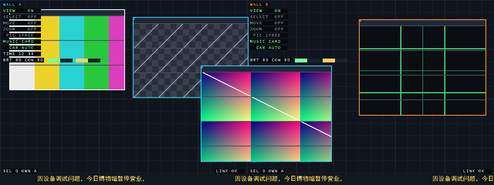

# 双屏无缝拼接多媒体播放墙 · Dual-EG4S20 Seamless Video Wall

> 2026 全国大学生嵌入式芯片与系统设计竞赛 · FPGA 创新设计赛道 · 安路赛题（选题一）参赛作品

两块安路 **EG4S20** 开发板、两根 HDMI、一条 J1 排线，拼成**一块 1280×480 的桌面**：
四个监控窗口、跨屏拖动与等比缩放、1:1 全屏相册、轮播转场、亮度/对比度实时调节、
背景音乐、34 字节状态遥测，以及一条**横跨两块屏连续滚动的中文通知字幕**。

**没有帧缓存。** 每个像素由 `(x, y)` 和一份窗口表当场算出，接缝对齐是**架构保证**的，
而不是靠两颗芯片去同步两个帧缓冲——同一张表、同一个函数，接缝就不可能错位。



> 上图是 **RTL 仿真渲染**（`tb_hero`：两块 `wall_scene` 各画半屏，默认窗口表，HUD 与滚动字幕打开），
> 与真板输出走的是同一套逻辑，不是效果图。跨缝的字幕与窗口在缝处连续——就是这套设计要证明的事。

## 它能做什么

| 能力 | 说明 |
|---|---|
| **无缝拼接** | 逻辑上是一块 1280×480 桌面；跨缝 614,400 像素逐像素比对 **0 差异**（`tb_scene`） |
| **四窗口桌面** | 彩条 / 棋盘 / 渐变 / 十字四种可辨识图案，各自有位置、尺寸、层序、归属、内容源 |
| **跨屏拖动** | 1 px/步，长按 0.5 s 后 4 px/步；窗口中心越过 x=640 归属由 A 转 B，改由 B 板按键继续拖 |
| **等比缩放** | 4 bit DDA 采样，围绕窗口中心，不拉伸；宽 40~640 / 高 40~480 |
| **置顶 / 置底** | 2 bit 层序直接改写，实时生效 |
| **亮度 / 对比度** | 每张图独立，8 bit，0x80 中性；按键实时调，OSD 显示当前值，同按一对 1 s 复位 |
| **全屏相册** | SW4 上拨：整面墙变成一张 640×480 照片的**实际像素**（1:1 跨缝居中，左右各 320 px 黑边）；KEY4/KEY3 切四张，切页 ≈567 ms 淡出淡入 |
| **轮播转场** | 约 4.3 s 一张，16 帧淡变（≈533 ms），A/B 同步 |
| **中文滚动字幕** | 16×16 字模、60 px/s、512 px 无缝周期，**跨两块屏连续**；VIEW 模式下长按 KEY2 开关 |
| **背景音乐** | A 板从 TF 卡读 48 kHz/16 bit 立体声 WAV 循环播放；卡上没有 WAV 时自动回落片上合成器，不会静音 |
| **降级与自愈** | 拔掉 J1 排线：A 屏 `LINK LOST`、B 屏 `FROZEN`；插回 3 帧内恢复，窗口位置接续 |
| **全链路可观测** | 每板 34 B/帧、10 帧/s 的 UART 状态帧：链路、同步、视频锁定、窗口表、加载器阶段、SDRAM 自检、相册页码、读口迟滞、HUD 计时 |

## 怎么做到的（四个关键点）

1. **零帧缓存**：像素 = `f(x, y, 窗口表)`。没有帧缓冲，就没有"两个缓冲不一致"这个失败模式。
2. **单写者窗口表 + 每帧整表广播**：只有 A 板能改表；每帧把 4×64 bit 记录连同状态塞进 40 B 的 STATE 负载，
   经 4 bit @6.25 MHz 的 J1 链路（CRC8）发给 B。B 零决策、零写权限，从根上排除双节点改表抖动。
3. **无应答自愈图片分发**：8 个区域、一轮 83,712 块循环推送，丢块下一轮自然补齐——不需要重传协议和超时状态机。
4. **跨节点同相位的字幕**：滚动相位不从本地计数器来，而是 A 把 `frame_cnt[8:0]` 广播给 B（借用 STATE 帧里两个原本恒零的空位，
   负载长度不变），配合 512 px 整周期把字符串补齐成 32 个字格，因此循环无缝、接缝处字形不撕裂。

## 指标（TD 6.2 实测）

| | A 板（主 / MASTER） | B 板（从 / SLAVE） |
|---|---|---|
| LUT | **13,811 / 19,600 = 70.46%** | **9,331 / 19,600 = 47.61%** |
| REG | 8,214 | 6,176 |
| BRAM / DSP | 31 / 64 · 14 / 29 | 31 / 64 · 13 / 29 |
| 25 MHz 像素时钟 Setup WNS | **+0.557 ns** | **+0.347 ns** |
| 150 MHz SDRAM 时钟 Setup WNS | **+0.353 ns** | **+0.185 ns** |
| 时序违例 | 0 | 0 |

- 构建：`build/release/20261031_211735_A` · `20261031_212015_B`
- 回归：**24 个 testbench 全 PASS**（跨缝逐像素、行缓冲列宽上界、链路 CRC、8 区域逐块逐字、相册切页、字幕 3 相位逐像素……）
- 资源占用：RTL 31 文件 8,332 行，testbench 35 文件 4,840 行；SDRAM **2,097,152 字全用满**
- 上电：桌面约 2 s、四张照片 5~8 s、两屏齐全 ~10 s

## 硬件

| 项 | 规格 |
|---|---|
| 开发板 | 安路 EG4S20BG256（HX4S20C）× 2 |
| 显示 | 640×480@60 HDMI × 2（25 MHz 像素时钟，800×525 总时序） |
| 存储 | 板载 2M×32 SDRAM @150 MHz（2,097,152 字，全部用满）+ W25Q16 配置 Flash |
| 板间链路 | J1 排线：4 bit 数据 @6.25 MHz，双向（A→B 状态/图，B→A 按键） |
| 卡 | A 板 TF 卡（FAT32，MBR 分区起始 LBA 32），根目录 CAM1..4.BMP（640×480 / 24 bit / 无压缩） |
| 交互 | 4 个拨码开关 + 4 个按键，6 种互斥工作模式 |
| 遥测 | 每板一路 UART，115200 8N1 |

## 快速开始

### 1. 只想看画面（不需要硬件，不需要厂商 IP）

```powershell
cd sim_c3
vlog -work work ../rtl/wall_font_rom.v ../rtl/wall_font_cn.v ../rtl/wall_marquee.v `
     ../rtl/wall_raster.v ../rtl/wall_scene.v ../rtl/wall_state.v ../rtl/wall_input.v `
     ../rtl/wall_link.v ../rtl/wall_hud.v ../rtl/wall_pic_line.v ../rtl/wall_pic_prefetch.v `
     ../rtl/wall_clock.v ../rtl/wall_carousel.v ../rtl/wall_picadj.v ../rtl/wall_zoom_calc.v `
     ../rtl/wall_img_push.v ../rtl/wall_img_recv.v ../rtl/wall_album_seq.v ../rtl/wall_tf_load.v
vlog -work work ../tb/tb_hero.v
vsim -c -do "run -all; quit -f" tb_hero +DUMP     # 输出 world_1280x480.ppm（1280×480 整墙）
```

### 2. 跑回归

```powershell
cd sim_c3
powershell -ExecutionPolicy Bypass -File run.ps1        # 24 个 testbench
```

### 3. 综合 + 布局布线（**需要安路官方 HDMI 例程**）

```powershell
powershell -ExecutionPolicy Bypass -File build\build.ps1 -Role both
# 产物：build/td_A/WALL_A.bit、build/td_B/WALL_B.bit，以及 area.rpt / final_timing.rpt
```

> ⚠ **本仓库不含厂商加密 IP**：HDMI 发送器（APUG092）、PLL 等来自安路官方例程 `fpga_hdmi/`，
> 按授权不能公开，已从仓库排除（见 `THIRD_PARTY_NOTICES.md`）。`rtl/` 里是**本项目自己的全部逻辑**，
> 把 `fpga_hdmi/` 放回工作区同一层级即可完整构建。

### 4. 烧板与遥测

```powershell
powershell -ExecutionPolicy Bypass -File tools\probe_flash.ps1 -Flash    # cable 0 = A，cable 1 = B
powershell -ExecutionPolicy Bypass -File tools\persist_pair.ps1          # 写入配置 Flash（掉电自启）
powershell -ExecutionPolicy Bypass -File tools\read_status.ps1 -Ports COM7,COM9
```

## 按键与开关

| SW1 | 模式 | KEY4 | KEY3 | KEY2 | KEY1 |
|---|---|---|---|---|---|
| ↓ | VIEW 观看 | 轮播自动/停 | 手动下一张 | **短按**=UI 显隐；**长按 1 s**=底部字幕 | 静音 |
| ↑ + SW4 ↑ | 全屏相册 | 下一张 | 上一张 | — | — |
| ↑ + SW2 ↑ SW3 ↑ SW4 ↓ | 亮度/对比度 | 亮度 + | 亮度 − | 对比度 + | 对比度 − |
| ↑ + SW2 ↑ SW3 ↓ SW4 ↓ | MOVE（先锁定） | 上 | 下 | 左 | 右 |
| ↑ + SW2 ↓ SW3 ↑ SW4 ↓ | ZOOM（先锁定） | 放大 | 缩小 | 快放 | 快缩 |
| ↑ + SW2 ↓ SW3 ↓ SW4 ↓ | 基础层 SELECT | 选图 | 确认/解锁 | 置顶 | 置底 |

## 目录结构

```
wall/
├─ rtl/            本项目全部 Verilog（31 文件 8,332 行；另一份 4 文件的 SD 卡驱动在 rtl/sd/）
├─ tb/             24 个回归 testbench（35 文件 4,840 行）
├─ sim_c3/         ModelSim 回归脚本 run.ps1
├─ tools/          中文字模生成、状态帧读取、烧录、配置 Flash、BMP/WAV 生成等脚本
├─ build/          TD 6.2 构建脚本（双角色 + 隐式网络检查 + 报表归档）
├─ pin/            引脚与时序约束（.adc / .sdc，构建必需）
├─ media/          渲染图与素材
└─ docs/           协议规范、各阶段设计记录、比赛材料
```

## 文档

| 文件 | 内容 |
|---|---|
| `docs/01_spec.md` | **接口与协议规范**：窗口记录位段、STATE 负载逐字节定义、链路帧格式 |
| `docs/10_album_plan.md` | 相册模式的完整设计记录（C3→C9-R3，含抖动问题的定量收敛过程） |
| `docs/14_marquee.md` | 滚动字幕：跨屏相位广播、字模生成、两个只有上板才暴露的 bug 的复盘 |
| `docs/13_delta_after_c9r3.md` | 最近一轮改动的增量说明 |
| `docs/contest/` | 比赛材料（技术文档 / 简介 / 视频脚本 / 海报 / 答辩 QA / 授权书） |

## 已知限制

- **不含厂商加密 IP**，clone 后不能直接综合出 bit，需自备安路官方 HDMI 例程（见上）。
- 图片源固定为 TF 卡根目录的 4 张 640×480 24 bit BMP；`MUSIC.WAV` 未提供时使用片上合成器（音色单调）。
- 相册固定 4 张（页码 2 bit），不支持任意张数。
- 主要验证环境：TD 6.2 + ModelSim ASE + Windows PowerShell；Linux 下的构建脚本未经验证。

## 团队与许可

2026 全国大学生嵌入式芯片与系统设计竞赛 · FPGA 创新设计赛道 · 安路赛题（选题一）

队伍 **43927「中门鸟狙王」** —— 丁许钊、喻展轩、周健峰　指导老师：梁娇娇

代码以 **MIT** 许可发布（见 `LICENSE`）；第三方组件与厂商 IP 的归属见 `THIRD_PARTY_NOTICES.md`。

---

## 开发笔记（原 README 正文，保留全过程记录）

> 下面是开发过程中的原始记录：每一步解决的问题、诊断数据、被推翻的结论都在里面，
> 按时间顺序排列，不修饰。想快速了解作品看上面即可。

### 当前状态（2026-10-31）

| 项 | 状态 |
|---|---|
| 接口/协议规范 | `docs/01_spec.md` |
| ModelSim 跨接缝逐像素比对 | **PASS**（614,400 像素，0 差异） |
| 链路帧 CRC / 错帧拒绝 / 重同步 | **PASS** |
| 双节点端到端（含拔线降级/恢复） | **PASS**（`tb_node`，需 `fpga_hdmi` 的硬 IP 源码，不在本机现成库里） |
| TD 综合 + P&R + STA | **PASS（C10）**（A 25 MHz +0.557 / 150 MHz +0.353 ns，B +0.347 / +0.185，0 违例；LUT 13811 / 9331） |
| 双板烧录 | **OK**：C9 / C9-R1 两片都已用 `tools/probe_flash.ps1 -Flash` 烧上（cable 0 = A / cable 1 = B，每次都 FLASH_OK） |
| 配置 Flash（掉电自启） | **OK（2026-10-31 19:0x 重写）**：两片的 W25Q16 都写入了当前 C9-R3 的 bit（`tools/persist_pair.ps1`，每片 `PROG/VERIFY/REFRESH` 全 OK；最后的 `refresh` 就是从 Flash 重新配置，起来后仍是 node=A / node=B），所以拔掉 JTAG 上电也能各自起成 A / B。**以后每次重建都要重新 persist 一次**，否则掉电会回到这一版 |
| HDMI 发送器锁定 | **OK**（两板 video_locked=1 / state=RUN，见 docs/02_bringup_log.md） |
| genlock | **OK**（B 板 sync=1） |
| 两板窗口表一致 | **OK**（UART 读到两边 gx=0x018 / sel=0） |
| SDRAM 上电自检 | **OK**（两板 done=1 / failed=0 / errors=0） |
| TF 卡初始化 + 整扇区读 | **OK（A 板）**：`sd_init_done=1`、`bytes=255/255`、`read_end=1`；B 板卡座空 |
| SD 读通路自证 | **OK（A 板）**：同一份 bit 读 CID，`41 34 32 53 44 31 36 47…`（PNM=`SD16G`）+ 2 字节 CRC，CRC-16 与算出来的一致 → 6.25 MHz 下逐位正确（docs/02_bringup_log.md 19） |
| 卡内数据 | **不是空卡**：LBA 0 是 **MBR 分区表**（type 0x0C，卷起始 **LBA 32**，约 7.2 GiB），FAT32 卷里有 CAM1..4.BMP。§20 更正了 §16/§18/§19 的"空卡"结论 |
| 图片通路（W2.1） | **OK**：4×96×72 RGB444 图库进 BRAM（已被行缓冲取代，见 §5 的 `rtl/unused/`） |
| TF 装载器（W2.2） | **OK（A 板）**：`phase=6 / err=0 / found=000F / bank_ok=000F`，4 张照片已写入图库；仿真两种卷布局各 27648/27648 字全对 |
| 全分辨率拷贝（C2a→C9） | **OK**：加载器给 **CAM1..CAM4 每一张**按 640×480 1:1 写进 SDRAM（619,520 起，第 n 张 `619,520+n×307,200`，共 1,228,800 字）；`tb_tf_load` 逐字比对 `1228800/1228800`（四份全对，不是抽查） |
| 相册（大屏）模式（C3/C4/C5） | **OK**：SW4 上拨 → 整屏一张照片、实际像素 1:1、居中跨缝、进出各 16 帧淡入淡出（533 ms）；A→B 链路每轮推 83,712 块。详见 `docs/10_album_plan.md` |
| 相册四张切页（C9） | **OK**：CAM1..CAM4 各有一份 1:1 拷贝，相册里 **KEY4 = 下一张 / KEY3 = 上一张**，页码写进窗口记录 `[60:59]`，B 靠 STATE 帧自动跟随；WAV 因此缩到 619,520 字（约 12.9 s）。`tb_album_page` / `tb_pic_line`（页 2、3 逐字）覆盖 |
| 切页渐变 + 读口抖动（C9-R2） | **OK**：相册切页改成和进出相册同一条淡出/淡入（≈567 ms）。上下移动时的抖动 = **行缓冲的 4 个 192 字 burst 超过一行预算**（见 `docs/10` C9-R2）：现在每片板只取**自己半屏画得到**的窗口（`NODE_X0/NODE_W` 闸门，典型布局省 25~50% 的 burst），并新增 `late_cnt` 诊断（状态帧 byte 11，0 = 读口跟得上） |
| 图三在 A 屏那条还抖（C9-R3） | **已修**：A 板要取 3 个窗口（含跨缝那个），而跨缝窗口在 150 MHz 取数顺序里永远排最后 → `wall_pic_prefetch` 新增 `nxt_c1`（本节点最多能看到第几列），把它的 burst 从 192 字截到 45 字（A 每行 576→429 字）。状态帧 byte 11/byte 19 bits[6:3] 现在能读出"哪几个窗口挨饿"：改前 A=`0100`/worst 13，改后两片都 `0000`/0 |
| 轮播取图源（C9-R1） | **已修**：C3 重写 `wall_pic_line` 时把 `car_cyc` 从取图地址里丢了 → 从 C3 到 C9，VIEW 的 KEY3 单步和自动轮播**只动相位不动画面**。现在取图源 = `窗口 + 相位`，`tb_carousel` 修好位宽后重新纳入回归并通过 |
| VIEW 模式按键（C6） | **OK**：KEY2 = 整屏 UI 显示/隐藏，KEY1 = 静音（卡 WAV + 片上合成器一起静），状态随 STATE 帧广播 |
| 底部滚动字幕（C10） | **已上板（20:1x）**：屏幕底部 28 行深色条上滚一行 **中文 16×16** 字幕（因设备调试问题，今日博物馆暂停营业，，60 px/s，512 px 无缝循环）；VIEW 模式 **长按 KEY2 ≥1 s** 开关，相册模式自动隐藏。两板相位由 A 广播（rame_cnt[8:0]，揣在 STATE 帧 byte4 bit7），所以接缝处字形不会撕开 |
| 开关映射（C7） | **OK**：SW4 = 全屏，SW1+SW2+SW3 全上 = 亮度/对比度（原来是反的） |
| 窗口内容 | **卡里的照片**（上电 1~2 s 后覆盖测试图案）；A 把四张缩略图 + 全分辨率图经链路推给 B |
| 上板画面验收 | **待用户目视** |

---

## 1. 板上应该看到什么

两块 640×480 屏并排，逻辑上是一块 **1280×480 的桌面**（A 在左，B 在右）：

```
A 屏 (0..639)                          B 屏 (640..1279)
┌───────────────────────────┐         ┌───────────────────────────┐
│ WALL A                    │         │ WALL B                    │
│  ┌──────────┐             │         │        ┌──────────────┐   │
│  │ 彩条      │  ┌────────┐ │         │        │ 渐变窗口右半 │   │
│  │ 窗口 0    │  │棋盘窗口 │ │  接缝   │        │ (跨接缝)     │   │
│  └──────────┘  └────────┘ │         │        └──────────────┘   │
│            ┌──────────────┴─────────┴──────────────┐           │
│            │ 渐变窗口（左 120 px 在 A，右 220 px 在 B）│          │
│            └───────────────────────────────────────┘           │
│                                │         │   ┌────────────┐    │
│ SEL 0 OWN A   GX 018           │         │   │ 导航窗口 3  │    │
│ LINK OK       SYNC OK          │         │   │ OWN B      │    │
└───────────────────────────┘         └───────────────────────────┘
```

- 两屏右上角各有 **WALL A / WALL B** 标签（A 青色、B 橙色）
- 左下 **SEL n OWN x**：当前选中窗口与它的控制方
- 左下 **GX hhh**：选中窗口的全局 x（3 位十六进制）
- 右下 **LINK OK / LINK LOST**、**SYNC OK / NO SYNC**
- 跨接缝的渐变窗口：**接缝两侧必须严丝合缝**

### 按键与开关

| 器件 | 引脚 | 功能 |
|---|---|---|
| SW1 (C8) | 滑动开关 | 上拨 = 操作模式；下拨 = 观看模式（自动放弃确认，四个键改做观看功能） |
| SW2 (C7) | 滑动开关 | 上拨（配合 SW3 下拨）→ 移动层；两个都上拨 → 亮度/对比度层 |
| SW3 (C6) | 滑动开关 | 上拨（配合 SW2 下拨）→ 缩放层；两个都上拨 → 亮度/对比度层 |
| SW4 (C5) | 滑动开关 | **上拨 = 全屏（相册）模式**，优先级最高 |
| KEY4 (C1) | 按键 | 基础层：**选图**；移动层：上；缩放层：放大；VIEW：轮播自动/停止；亮部/对比度：**亮度 +**；**全屏：下一张** |
| KEY3 (B1) | 按键 | 基础层：**确认图片**；移动层：下；缩放层：缩小；VIEW：手动切下一张；亮度/对比度：**亮度 −**；**全屏：上一张** |
| KEY2 (B2) | 按键 | 基础层：**置顶**；移动层：左；缩放层：快速放大；VIEW：**短按 = UI 显示/隐藏、长按 1 s = 底部滚动字幕开关**；亮度/对比度：**对比度 +**；全屏：无 |
| KEY1 (A2) | 按键 | 基础层：**置底**；移动层：右；缩放层：快速缩小；VIEW：**静音**；亮度/对比度：**对比度 −**；全屏：无 |

**模式解码（互斥，SW4 最高优先）**：

| SW1 | SW2 | SW3 | SW4 | 模式 |
|---|---|---|---|---|
| 0 | x | x | x | VIEW（观看） |
| 1 | x | x | **1** | **全屏相册** |
| 1 | **1** | **1** | 0 | **亮度/对比度** |
| 1 | 1 | 0 | 0 | MOVE（需要图片已确认） |
| 1 | 0 | 1 | 0 | ZOOM（需要图片已确认） |
| 1 | 0 | 0 | 0 | 基础层（选图/确认/置顶/置底） |

> C7（2026-10-31）：SW4 和 SW1+SW2+SW3 **互换**过——SW4 原来是亮度/对比度，
> 三个一起上原来是相册。现在反过来了。

* 移动：按一下 1 px，按住连发 ~30 Hz，**按住超过 0.5 s 后每步 4 px**
* 缩放：以窗口中心为基准，**等比**：`wall_zoom_calc` 每帧算一个供两个轴共用的 Q16 步长
  `step = max((96<<16)/(w-4), (72<<16)/(h-16))`，并把绘制尺寸 `dw=(96<<16)/step`、
  `dh=(72<<16)/step` 一起给场景；场景把 `dw×dh` 的图**居中**画在内容区里，空出来的那边留黑边。
  默认 300×210 → step 24322、图 258×194（左右各 19 px 黑边），不再被横向拉伸。
  慢速键 ±1 档、快速键 ±4 档（`W_STP/W_FST = 16/64`、`H_STP/H_FST = 12/48`），
  `w∈[40,640]`、`h∈[40,480]`，并且每个窗口各用自己的一份步长
  （曾经因为索引打了一拍，缩放 window0 会带着 window1 的图一起变，已修 + `tb_zoom` 覆盖）。
* 置顶/置底：直接改表项里的 2 bit `z`（3 = 最上，0 = 最下）
* 归属只在**取消确认/切到观看模式**那一刻按窗口中心判定（越过 x=640 归 B）

**VIEW 模式（SW1 下拨）的四个键**：KEY4 = 轮播自动/停止，KEY3 = 手动切下一张，
**KEY2 = 整屏 UI 显示/隐藏**（HUD 全部，包括左上角 `WALL A/B` 标签和音频电平条），
**KEY1 = 静音**（卡里的 WAV 和片上合成器一起静音，MUSIC 那行变成 `MUSIC MUTE`）。
这两个状态通过 STATE 帧广播，所以两片屏一起隐藏、一起静音。

**全屏（相册）模式**：进入时把当前 256 bit 窗口表**快照**，写进一条"无边框"记录
（`frameless` = 记录 bit 58）覆盖整屏，退出时原样写回。
照片来自加载器给**每一张**照片多写的那份 640×480 1:1 拷贝
（SDRAM 619,520 起，四份连续、第 n 张在 `619,520 + n×307,200`），
**一个源像素对一个屏幕像素**，居中跨缝（世界 x 320..959）、左右各 320 px 黑边，
HUD 和电平条全部关掉，轮播淡入淡出强制 255。
**KEY4 = 下一张、KEY3 = 上一张**（C9）：记录 bit `[60:59]` 就是页码，
改一次表只写 slot 0，B 从下一帧 STATE 帧里自动看到同一页；
切页也走**和进出相册同一条淡出/淡入**（C9-R2，各 16 帧，合计 ≈567 ms），
淡出期间画面还是旧图，全黑那一刻才换记录。
进 / 出各 **16 帧**淡出淡入（合计 533 ms，和轮播换图同节奏），
淡的是最后一级整幅合成，所以桌面、边框、字幕一起暗下去。详见 `docs/10_album_plan.md`。

> SW1/SW2 的"上拨"到底读 1 还是 0 取决于开关装法；实测两片都反相，所以
> `wall_top.v` 里 `SW_INV = 1`。要整体反相只改这一位。

### SDRAM 图库地址表（C9：正好用满 2,097,152 字）

| 区域 | 地址 | 大小 | 说明 |
|---|---|---|---|
| MUSIC.WAV | 0 … 619,519 | 619,520 | 48 kHz 立体声 16 bit ≈ **12.9 s**（C9 前是 1,249,999 字 ≈ 26 s） |
| HI0 (CAM1) | 619,520 … 926,719 | 307,200 | 640×480 1:1 |
| HI1 (CAM2) | 926,720 … 1,233,919 | 307,200 | |
| HI2 (CAM3) | 1,233,920 … 1,541,119 | 307,200 | |
| HI3 (CAM4) | 1,541,120 … 1,848,319 | 307,200 | |
| 四张缩略图 | 1,848,320 … 2,097,151 | 4 × 62,208 | 槽间隔 62,208（288×216），只用前 27,648 |

`619,520 + 4×307,200 + 4×62,208 = 2,097,152`。5 处常量必须一致：
`wall_tf_load` / `wall_img_push` / `wall_img_recv` / `wall_pic_line` / `wall_top`。

### LED

| LED | 含义 |
|---|---|
| LED1 (A4) | 链路正常（收到对端帧） |
| LED2 (A3) | 心跳 ~1.5 Hz |
| LED3 (C10) | 正在渲染（帧活动） |
| LED4 (B12) | 链路丢失 |

---

## 2. 接线（与 murmur_d1 同一根排线）

J1 ↔ J1，同脚号对接（40P，**必须抽掉第 11、29 脚**，保留 12/30 GND）：

| 信号 | J1 脚 | FPGA 球 | 方向 |
|---|---|---|---|
| link_d[0] | 1 | D14 | A→B |
| link_sync | 2 | G11 | A→B |
| link_vld | 4 | F13 | A→B |
| link_d[1] | 6 | H14 | A→B |
| link_d[2] | 5 | H13 | A→B |
| link_d[3] | 7 | J14 | A→B |
| link_clk | 9 | K12 | A→B |
| link_bd[0] | 13 | M14 | B→A |
| link_bd[1] | 15 | L10 | B→A |
| link_bd[2] | 17 | D16 | B→A |
| link_bd[3] | 19 | F14 | B→A |
| link_bvld | 21 | G16 | B→A |

> 这就是 murmur_d1 里 `d1p6` 版本的脚位（D1 已从 J1-3 改到 J1-6）。
> 如果之前那根线还在，**不用重做**。

---

## 3. 仿真

```powershell
cd wall
vlib work
vlog -work work rtl\wall_font_rom.v rtl\wall_raster.v rtl\wall_scene.v rtl\wall_state.v `
              rtl\wall_input.v rtl\wall_link.v rtl\wall_top.v tb\stubs.v
vlog -work work tb\tb_scene.v tb\tb_link.v tb\tb_node.v
vsim -c -do "run -all; quit -f" tb_scene   # 跨接缝 0 像素
vsim -c -do "run -all; quit -f" tb_link    # 帧 CRC / 错帧
vsim -c -do "run -all; quit -f" tb_node    # 双节点 + 拔线降级
```

`tb_scene` 的做法：一个"宽节点"（NODE_X0=0、可渲染 x=0..1279）作为真值，
A 半屏和 B 半屏分别与它逐像素比对。**接缝 (639,640) 这一对像素也在比对范围内**，
所以"接缝 0 像素误差"不是肉眼结论，是 614,400 次比较的结论。

视觉/时序 TB（每次改画面或改链路都要全跑）：

```powershell
vlog -work work rtl\wall_font_rom.v rtl\wall_font_cn.v rtl\wall_marquee.v rtl\wall_scene.v rtl\wall_hud.v `
              rtl\wall_pic_line.v rtl\wall_pic_prefetch.v rtl\wall_clock.v `
              rtl\wall_carousel.v rtl\wall_picadj.v rtl\wall_link.v `
              rtl\wall_zoom_calc.v rtl\wall_img_push.v rtl\wall_img_recv.v `
              rtl\wall_state.v rtl\wall_input.v rtl\wall_album_seq.v
vlog -work work tb\tb_scene.v tb\tb_img.v tb\tb_pic_line.v tb\tb_pipe_eq.v `
              tb\tb_hud_dump.v tb\tb_clock.v tb\tb_carousel_ctrl.v tb\tb_link.v tb\tb_picadj.v `
              tb\tb_zoom.v tb\tb_album.v tb\tb_album_tbl.v tb\tb_album_page.v tb\tb_img_link.v tb\tb_carousel.v tb\tb_prefetch_node.v tb\tb_marquee.v `
              tb\tb_drag.v tb\tb_mute.v tb\tb_tf_load.v tb\tb_tf_load_mbr.v tb\tb_wav.v tb\stubs.v
vsim -c -do "run -all; quit -f" tb_scene         # 614,400 像素 + 接缝，必须 PASS
vsim -c -do "run -all; quit -f" tb_img           # 行缓冲 -> 场景 276 像素照片映射
vsim -c -do "run -all; quit -f" tb_pic_line      # 行缓冲换行不撕裂 + 640 字 album burst + 页 0/2/3 逐字
vsim -c -do "run -all; quit -f" tb_pipe_eq       # 输出打一拍前后逐像素等价
vsim -c -do "run -all; quit -f" tb_hud_dump      # TIME / CAR 两行渲染成 PPM
vsim -c -do "run -all; quit -f" tb_clock         # 时钟 BCD 进位，跑满 100 分钟
vsim -c -do "run -all; quit -f" tb_carousel_ctrl # 轮播淡入淡出 + 黑场切换
vsim -c -do "run -all; quit -f" tb_link          # 40 字节 STATE 帧 + 错帧重同步
vsim -c -do "run -all; quit -f" tb_picadj        # 亮度/对比度算术，扫 0..255 全值
vsim -c -do "run -all; quit -f" tb_zoom          # 等比缩放步长
vsim -c -do "run -all; quit -f" tb_album         # 相册几何：step 65536 / 640x480 / 1280 像素 1:1
vsim -c -do "run -all; quit -f" tb_album_tbl     # 表快照/还原 + 只在全黑时换表 + 淡入 16 帧 + 切页只改 slot0
vsim -c -do "run -all; quit -f" tb_img_link      # A 的 SDRAM -> 链路 -> B 的 SDRAM，8 个区域逐字
vsim -c -do "run -all; quit -f" tb_drag          # 拖拽/连发/边界
vsim -c -do "run -all; quit -f" tb_album_page    # 切页：0->1->2->3->0 回绕、只在 S_ALBUM 响应、页码跨进出保持
vsim -c -do "run -all; quit -f" tb_carousel      # 轮播相位真的换了取图源（C3 丢过、C9-R1 修回）
vsim -c -do "run -all; quit -f" tb_prefetch_node # C9-R2：每片板只取自己半屏画得到的窗口
vsim -c -do "run -all; quit -f" tb_mute          # 静音开关
```

`tb_pipe_eq` 同时挂一份"旧组合版"（x = 列号、直取组合结果）和一份"新流水版"
（x = 列号+1、取寄存器输出），在 3 张窗口表上逐像素比对；`+noadv` 参数去掉
x+1 补偿后必须 FAIL（负控），用来证明这个 TB 不是恒真。

`tb_hud_dump` 把字幕块渲染成 `hud_auto.ppm` / `hud_stop.ppm`，同时断言：
A 画两行，B 只画 CAR（TIME 是 A 独占）。人眼验收见 `docs/w3_hud.png`。

`tb_clock` 用 360,000 个帧脉冲（= 100 分钟）逐拍比对 BCD 输出。

`tb_carousel_ctrl` 跑 3 个完整 256 帧周期：亮度按 255→0→255 走、
**换图只在 gain=0 时发生**、自动模式关掉后亮度立刻回 255 且手动 step 立即生效。

`tb_link` 的 TX 必须把**所有**输入都接上（未接的输入端是 z，CRC 字节会变成 x，
接收端会拒掉一个本来完好的帧）。

`tb_album` 用 1280 个像素比对"1:1 映射 + 左右黑边 + HUD/电平条被关掉"；
`tb_album_tbl` 断言**窗口表只在 `level==0`（全黑）时被写**、淡出正好 16 帧、结束回到 16。

TF 装载器的两个 TB 要读 `tb/*.hex`，所以要么在 `wall/` 下跑，要么给库目录做一个
`tb` 链接：`mklink /J sim_s1\tb wall\tb`。

```powershell
vlog -work work rtl\wall_tf_load.v tb\tb_sd_sector.v tb\tb_tf_load.v tb\tb_wav.v
vsim -c -do "run -all; quit -f" tb_tf_load   # 110,592 抽样词 + 1,228,800 字（4 份 1:1 全对）
vsim -c -do "run -all; quit -f" tb_wav       # MUSIC.WAV 1000 帧 PCM 逐字节
```

## 4. 构建与烧录

```powershell
powershell -ExecutionPolicy Bypass -File build\build.ps1                        # 只构建两个角色
powershell -ExecutionPolicy Bypass -File build\build.ps1 -Role a -Flash         # JTAG 配置（掉电丢失）
powershell -ExecutionPolicy Bypass -File tools\persist_pair.ps1                 # 写配置 Flash（掉电保留，推荐）
powershell -ExecutionPolicy Bypass -File build\build.ps1 -Persist               # 同上，但会先重建一遍
```

`-Persist` / `persist_pair.ps1` 才是"断电也能自己起来"的那种：板载 **W25Q16（16 Mbit / 2 MB）** 配置 Flash，
629,632 B 的 bit 放在 Flash 偏移 0，上电由 FPGA 主 SPI 模式自举。流程（TD 没有单条命令）：

```
svfgen -chip EG4S20BG256 -scan_mode prog_spi  -flash W25Q16JV -flashsize 16 -bit X.bit -svf p.svf
program_svf -cable N -svf p.svf          # 擦除+写入，约 92 s，SVF 内含 TDO 比对
svfgen -scan_mode verify_spi ... -svf v.svf ; program_svf -cable N -svf v.svf   # 读回逐字节校验
svfgen -scan_mode refresh -svf r.svf     ; program_svf -cable N -svf r.svf      # 立刻从 Flash 重载
```

> `refresh` 那一步本身就是"从 Flash 重新加载 FPGA"，所以它能起来就等于验证了掉电自启。
> 写 Flash 期间板子会被重新配置（HDMI 断一下、串口静几秒），**中途断电会得到一个空白 Flash**
> （JTAG 仍然能用，重跑一遍就恢复）。

**先确认 cable 编号再烧**（2026-10-30 是 A=1/B=0，**2026-10-31 变成 A=0/B=1**，跟着 USB 枚举走）。
`build.ps1` 和 `flash_pair.ps1` / `persist_pair.ps1` 现在都接受 `-CableA` / `-CableB`，
默认值取的是当天实测的 **0 / 1**；换过插口后先跑一次：

```powershell
powershell -ExecutionPolicy Bypass -File tools\flash_pair.ps1 -VerifyOnly   # "有卡"的那块就是 A
```

**烧录必须验证，别信 cable 编号**（2026-10-30 踩了两次，2026-10-31 又踩一次）：
1. 一次 TD 调用里连写两条 download -cable 0 / -cable 1 时，第二条会沿用第一条的
   cable —— 两块板最后都成了后烧的那份 bit（现象：两屏都写 WALL B、串口 node 字节
   都是 B、link=0）。**一次调用只烧一块板**。
2. `-cable N` 跟着 USB 枚举走，换过插口就会互换。**2026-10-31 的实测是 cable 0 = A、
   cable 1 = B**（和 `build.ps1` 里写死的 `A=1 / B=0` 正好相反！），
   所以**别直接跑 `build.ps1 -Persist`**，会两片对调。以串口读到的"哪块有卡"为准。
3. 一键烧 + 自检：`powershell -ExecutionPolicy Bypass -File tools\flash_pair.ps1`
   （只查不烧：`-VerifyOnly`）。`tools\probe_flash.ps1` 还能解出每个状态帧里的
   `node/link/sel/gx/win_w/win_h/sd_flags/phase`，`-Flash` 则是"先烧再读"，
   用来确认"这块板到底跑的是哪份 bit、窗口表对不对"。
4. **别再信"能烧/不能烧"的直觉**：2026-10-31 有两次
   `PRG-9505 USB device open error`（设备管理器里 Anlogic 下载器是「错误 39」，
   `sc start CYUSB` 返回 4551），根因是 Windows 的
   `{8F9CB695-…}` "Cross Certificates for Code Integrity Exceptions" 策略在拦
   2011 年的 `cyusb.sys`，触发点是 **pod 重新枚举时要重新加载驱动**。
   所有系统设置都还原（HVCI 开、blocklist=1、无 nointegritychecks）之后又能烧了，
   所以**先断电重上电或拔插一次 USB 再试，别改动系统设置**。

**不要在两个作用域里同名声明同一个寄存器**（2026-10-30 踩的最贵的一个坑）：
copy_fade/copy_car_cyc/copy_car 曾在模块作用域和 g_slave 生成块里各声明一次。
ModelSim 按 IEEE 规则取**内层**（FSM 真正写的那个），仿真 10 个 TB 全过；TD 却把
assign fade_gain = copy_fade 绑到**外层没人驱动的那个**，于是板上 B 的 `fade_gain`
恒 0 —— 照片被乘成纯黑，car_cyc 恒 0 —— 轮播相位与 A 错开，而桌面/边框/字幕全正常。
教训：
- 生成块里的信号统一在模块作用域声明，生成块里只写逻辑；
- 加完 RTL 跑一遍重名扫描（`tools/dupscan.py`），别等上板；
- 「仿真过、板上不对」且症状是"某个值恒 0"时，先怀疑同名声明/驱动绑定。

**生成块圈地要小心（2026-10-30 的第二次翻车）**：给"主机才装卡栈"套 generate ... g_card ...
g_nocard 时，把后面 "Rendering" 那一节连同 `x_scene` 的声明一起圈了进去。Verilog 允许，
ModelSim 也只当成块内局部信号；TD 却在下面用它时认为**未声明**，按隐式 1 bit 线网处理：

    HDL-1007: undeclared symbol 'x_scene'      wall_top.v(1652)
    HDL-5007: actual bit length 1 differs ...  port 'x'
    SYN-5025: Using 0 for all undriven pins and nets

于是场景的 `x` 只有 bit0、`x[10:1]` 全接 0：每个像素横向重复（照片"拉长成条纹"）、
字符列全错（字幕消失），**而综合、布线、烧录全都正常通过**。教训：
- 生成块只圈**实例和它们的专属连线**，信号声明一律留在模块作用域；
- `build.ps1` 现在会扫日志，只要 `undeclared symbol` / `Undriven net` 指向 `wall/rtl` 就
  直接 `CHECK FAILED`；
- 出问题先 **diff 上一版能用的 build.log**，比盯屏幕快得多。

**主机才装卡栈**（2026-10-30，为腾面积）：SD 卡栈 + wall_tf_load + wall_music +
wall_sd_dump 只在 g_card（IS_MASTER）里实例化，从机 g_nocard 把对外的信号全部
拉 0。这一刀把 B 的 LUT 从 **7024 砍到 4431**。以后再加主机专有的东西，
记得同步在 g_nocard 里把这些输出拉 0 —— 拉漏了 TD 会报 undriven，算是一道保险。

**ADJUST（现在在 SW1+SW2+SW3 全上）的两个操作细节**：BRT/CON 数字右边各有一条 16 格
电平条（绿=亮度、琥珀=对比度，格子数 = 高半字节，所以 0x80 正好半满）；
**同时按住一对键 1 秒 = 把那一对复位成 0x80**（KEY3+KEY4 复亮度、KEY1+KEY2 复对比度），
按住期间单键的 ± 事件被屏蔽。B 板也能调（B 的按键通过 INPUT 帧作为 remote_press
进 A 的同一个状态机），B 的 ADJUST ON 字幕和绿色行由 STATE 帧 byte 4 的 bit1 镜像过来。

**时序余量靠 phys_opt 兜底**：150 MHz SDRAM 域历来只剩 0.1~0.7 ns，而它最差的那条路径是
网线延迟主导（cached adapter 里一条 fanout-40 的控制线），布局稍有变化就会翻负
（10-30 出现过 **−0.170 ns**）。所以构建流程是
`place → phys_opt -effort high -post_place → route → update_timing → final_timing.rpt → bitgen`。
post-place 一次就把那条路径从 −0.170 ns 抬到 **+0.168 ns**。

⚠️ **不要加 `phys_opt -post_route`**：TD 6.2.168116 在这个版本上会在
"Abnormal Timing Path check" 阶段直接 coredump（已实测出 minidump）。
另外 `report_timing_summary` 原本在 `route` 末尾自动跑，手动插了优化步骤之后必须
自己重跑一次，否则拿到的报告描述的是优化前的网表。

两个坑：**所有给 TD 的路径必须是正斜杠**（Tcl 会把 `\` 当转义，`C:\Users\...` 变成
`C:Usersjapsa...`，报 `Cannot open file`）；`program_svf` 的 `-cable` 没写在帮助里但确实有效。

产物：`build/td_A/WALL_A.bit`、`build/td_B/WALL_B.bit`（629,632 B），
`build/td_*/final_timing.rpt`。

各阶段时序（A / B）：

| 版本 | 25 MHz | 150 MHz | 备注 |
|---|---|---|---|
| W3 后 | +3.37 / +2.94 | +0.16 / +0.52 | hold HWNS +0.011 |
| C2a（相册数据通路） | +0.242 / +0.437 | +0.162 / +0.266 | BRAM 20→31（行缓存 8×640） |
| C5 第一版（8×9 调光器） | **−0.263** / +0.333 | 0.158 / — | **A 布线失败**（`RUN-8102`） |
| C5 第二版（8×5，移到 rgb_r 之后） | +1.641 / +0.178 | +0.220 / +0.140 | LUT 12743 |
| C6（UI/静音键） | +0.104 / +0.308 | +0.124 / +0.391 | LUT 12804 |
| C7（开关互换） | +0.215 / +0.360 | +0.261 / +0.733 | LUT 12777 / 8525，BRAM 31 / 31 |
| **C9（四张 1:1 相册）** | +0.265 / +0.504 | +0.518 / +0.247 | LUT 13083 / 8512，reg 8111 / 6082，BRAM 31 / 31；A 150 MHz 域 HWNS +0.004 |
| **C9-R1（轮播取图源）** | +0.914 / +0.192 | +0.276 / +0.339 | LUT 12858 / 8523，reg 8042 / 6084，BRAM 31 / 31；B 25 MHz hold +0.003 |
| **C9-R2（切页渐变 + 每片只取自己半屏）** | +0.220 / +0.404 | +0.140 / +0.578 | LUT 13112 / 8642，reg 8099 / 6084，BRAM 31 / 31；B 25 MHz hold +0.003 |
| **C9-R3（burst 截短到本节点列宽）** | +0.153 / +0.242 | +0.304 / +0.127 | LUT 13370 / 8993，reg 8216 / 6184，BRAM 31 / 31 |
| **C10（底部中文滚动字幕 + 时钟归零，当前）** | **+0.557 / +0.347** | **+0.353 / +0.185** | LUT 13811（70.46%）/ 9331（47.61%），reg 8214 / 6176 |

> 25 MHz 域的余量看起来大，但**这条链只剩 0.2 ns 级别的余量**（C5 那次一个乘法器就让它
> 翻负）。任何往 `x → 窗口求值 → z 选择 → 内容/HUD` 这条路上加逻辑的改动，
> 都要先看这张表。

## 5. 目录

```
wall/
├─ docs/01_spec.md          接口与协议规范（冻结）
├─ docs/10_album_plan.md    相册模式（C2a..C9-R2）的实现、踩坑、板级数字、验收步骤
├─ docs/11_handover_album_multi.md  任务 A（四张 1:1 相册）的交接书
├─ docs/12_handover_contest.md      ★ 比赛材料（填表/介绍/GitHub/视频）的交接书
├─ docs/13_delta_after_c9r3.md      抖动定稿（C9-R3）增量说明：给写比赛材料那个会话的补丁
├─ docs/14_marquee.md             底部滚动字幕（C10）的实现、时序、操作与待办
├─ docs/preview_pair.png    Python 金标准渲染（设计参考）
├─ docs/font_preview.png    8x8 字模
├─ rtl/
│  ├─ wall_raster.v         640x480@60 时序 + genlock
│  ├─ wall_scene.v          桌面 + 4 窗口 + z 序 + HUD（输出寄存器打一拍 + 整幅调光）
│  ├─ wall_clock.v          HUD 的 TIME 计时（BCD，60 帧 = 1 秒）
│  ├─ wall_carousel.v       轮播相位 + 淡入淡出包络（A 算，B 镜像）
│  ├─ wall_picadj.v         每张图的亮度/对比度（与 fade 合成成 gain/offset）
│  ├─ wall_paint / wall_window_eval / wall_textbox / wall_hud
│  ├─ wall_font_rom.v       由 tools/gen_font.py 生成（8×8 ASCII）
│  ├─ wall_font_cn.v        由 tools/gen_font_cn.py 生成（16×16 中文字幕字模）
│  ├─ wall_marquee.v        底部滚动字幕（相位由 A 广播，两板同相位）
│  ├─ wall_state.v          stage/snap/cur 三级流水（两帧量化）
│  ├─ wall_input.v          去抖 + 模式解码 + 拖拽/连发 + VIEW 键 + 相册切页键
│  ├─ wall_link.v           4bit nibble 帧 + CRC8
│  ├─ wall_pic_line.v       SDRAM 行缓存（2 bank ping-pong，行宽 640；1:1 拷贝按记录 [60:59] 选页）
│  ├─ wall_pic_prefetch.v   每行源行号 + 可见性 + 是否读 1:1 拷贝 + 页码
│  ├─ wall_img_push/recv.v  缩略图 + 4 份 1:1 块经链路 A→B（8 个区域，83,712 块）
│  ├─ wall_album_seq.v      全屏模式：窗口表快照/换表/还原 + 淡出淡入 + 页码
│  ├─ wall_zoom_calc.v      等比缩放（缩略图用 96/72 分子，全屏用 640/480）
│  └─ wall_top.v            节点 A/B 顶层
├─ rtl/unused/              已经不进综合的旧模块（wall_img_banks: 96x72 片内图库）
├─ tb/                      tb_scene / tb_img / tb_pic_line / tb_pipe_eq / tb_hud_dump /
│                           tb_clock / tb_carousel_ctrl / tb_link / tb_picadj / tb_zoom /
│                           tb_album / tb_album_tbl / tb_album_page / tb_img_link / tb_drag / tb_carousel /
│                           tb_prefetch_node / tb_marquee /
│                           tb_mute / tb_tf_load / tb_tf_load_mbr / tb_wav + 桩
├─ pin/                     wall_node_a.adc / wall_node_b.adc / *.sdc
├─ build/build.ps1          TD 构建 + 烧录
└─ tools/                   字模生成、金标准渲染、read_status.ps1、flash_pair.ps1、
                            probe_flash.ps1、dupscan.py
```

## 6. 下一步

1. **上板目视验收**：接缝、拖拽、拔线降级、genlock、全屏模式的 1:1 画质与淡入淡出、
   VIEW 模式的 UI 隐藏/静音。
2. 给两片各写一次**配置 Flash**（`-Persist`，注意用正确的 cable 号），
   现在两片都是 JTAG 临时配置，掉电就没了；而且第二块板的 Flash 里存的可能是 A 的 bit。
3. 相册模式已经能切 CAM1..CAM4 四张（C9）。还能做的是：切页也走淡入淡出（现为瞬间生效，
   最坏一行的延迟）、页号显示在 HUD 上（`hi_ready`/页码已经塞进状态帧 byte 19）。
   `tb_carousel.v` 已经从"陈旧 TB"扶正：它的位宽在 C3 之后就对不上了，修好位宽后立刻
   暴露出 **C3 重写 `wall_pic_line` 时把 `car_cyc` 从取图地址里丢了**（VIEW 的 KEY3 单步和
   自动轮播从 C3 起就是"只动相位不动画面"）。C9-R1 已修（取图源 = `窗口 + 相位`），
   `tb_carousel` 重新纳入回归并通过。
4. B 板偶尔出现"窗口表是乱的"（`win_w/win_h` 变成 0/960 之类）——重新配置就好，
   但根因还没找到，`tb_node` 需要 `fpga_hdmi` 的硬 IP 源码才能跑，值得补上覆盖。
5. 真·写者轮转（token ring）——当前 A 是唯一表写者，B 只发按键。
