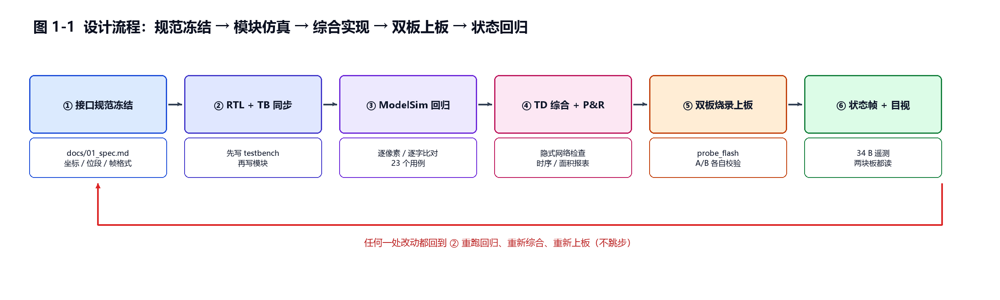
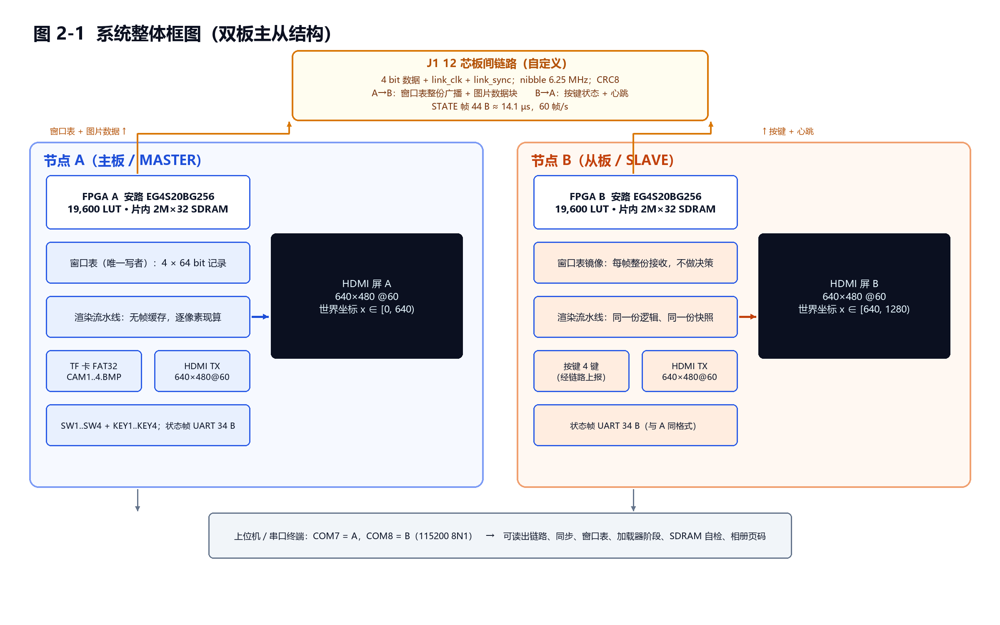
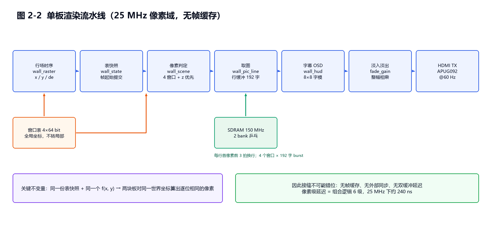
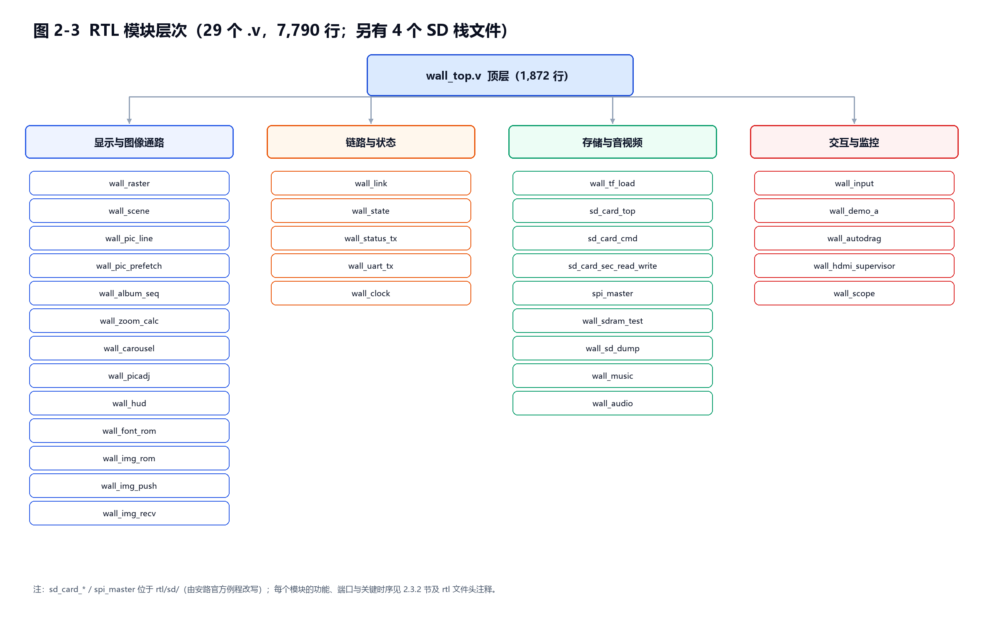
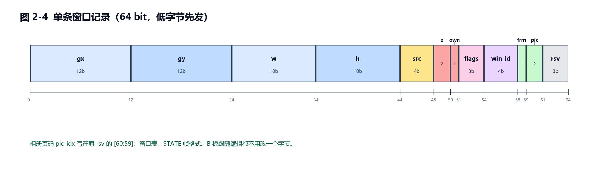
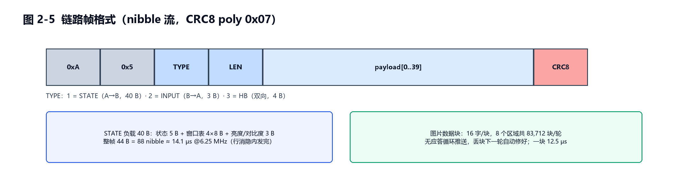
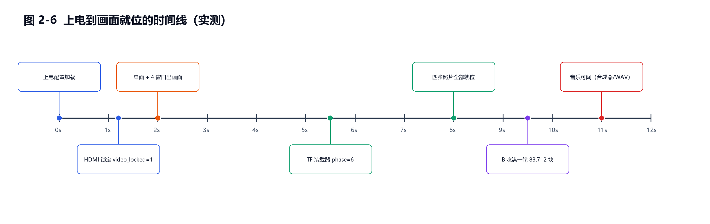

# 基于双安路FPGA的双屏无缝拼接多媒体播放墙

> 2026 年全国大学生嵌入式芯片与系统设计竞赛 · FPGA 创新设计赛道 · 安路科技赛题
> （选题一：基于安路 EG4S20 的 HDMI 多媒体播放系统）
>
> 队伍编号：43927　　队伍名称：中门鸟狙王
> 队员：丁许钊、喻展轩、周健峰　　指导老师：梁娇娇

## 摘要

本作品用**两块安路 HX4S20C 开发板**（FPGA 为 EG4S20BG256）各驱动一块 640×480 HDMI 显示屏，并排拼成一块逻辑上 **1280×480 的"桌面"**。桌面上有四个监控窗口，操作员可以用板载按键把任意窗口从左边那块板**拖到右边那块板**，窗口跨越两屏接缝时**逐像素无缝**，没有错位、没有撕裂、没有重影。两块板之间只有一根 12 芯排线，自定义 4 bit 同步链路，跑 CRC8 保护的帧协议。拔掉排线，两屏各自降级运行并显示 `LINK LOST`；插回排线，三帧之内自动恢复。

作品最核心的决定是**不做帧缓存**。每块板每个像素都是窗口表与坐标的纯函数 `f(x, y)`，两块板用同一份逻辑、同一份表快照，因此接缝两侧对同一世界坐标一定算出逐位相同的像素——拼接一致性不是靠"外部同步把两个帧缓冲对齐"换来的，而是**由架构本身保证**。A 板是窗口表唯一写者，每帧把 4 条 64 bit 窗口记录整份广播给 B 板，B 板只做显示、不做任何决策，从根本上消除了两节点同时改表导致的抖动。

图像源来自 A 板 TF 卡中的 BMP 图片：FAT32 解析后由装载器逐张写入片上 2M×32 SDRAM（四张 640×480 全分辨率拷贝 + 四张 192×144 缩略图，正好用满 2,097,152 字）。缩略图与全分辨率图被切成 16 字一块，由 A 板在链路上**无应答循环推送**给 B 板，一轮 8 个区域共 83,712 块，约 1 秒收满；任何一块丢失都会在下一轮自动补上。相册模式把整面墙变成一张 640×480 照片的**实际像素**（1:1 无缩放），跨接缝居中、左右黑边，按 KEY4/KEY3 在四张照片之间切换，进出与切页都走 16 帧淡入淡出。

系统还实现了 4 bit DDA 图像缩放、亮度/对比度实时调节与 OSD 数值叠加、HUD 字幕（时间与轮播状态）、**跨两块屏连续滚动的底部中文通知字幕**（16×16 字模、长按按键开关）、背景音乐双通路（TF 卡 WAV 与片上合成器回退）、以及 34 字节@115200 的状态帧遥测，两块板都能把链路、同步、窗口表、加载器阶段、SDRAM 自检、相册页码与 HUD 计时器读出来。整套设计 31 个 RTL 文件 8,332 行，A 板占用 13,811 LUT（70.46%）、B 板 9,331 LUT（47.61%），25 MHz 像素时钟与 150 MHz SDRAM 时钟**零时序违例**（A 板余量 +0.557 ns / +0.353 ns，B 板 +0.347 ns / +0.185 ns），24 个 testbench 全部通过，跨接缝逐像素比对 614,400 个像素 0 差异。

---

## 第一部分  作品概述

### 1.1 功能与特性

**双屏拼接**：两块 640×480 屏并排，逻辑上是一块 1280×480 的桌面；两块板共用一份渲染逻辑，接缝处无错位、无色差、无撕裂。上电第一帧就是跨接缝状态，不依赖现场摆位。

**四窗口桌面**：桌面上有四个监控窗口（彩条、棋盘、渐变、十字四种可辨识图案），每个窗口有独立的位置、尺寸、层序、归属和内容源；支持选中高亮、跨屏拖动、等比缩放、置顶/置底、亮度与对比度独立调节。

**跨屏拖动与归属转移**：在基础层选中窗口、确认后进入 MOVE 层，按一下移动 1 px，按住 0.5 s 后每步 4 px；窗口中心越过 x=640 后归属由 A 转为 B，改由 B 板的按键继续拖动。

**全屏相册模式**：SW4 上拨，整面墙变成一张 640×480 照片的实际像素，1:1 跨接缝居中显示；KEY4/KEY3 在四张照片之间切换，切页与进出都走 16 帧淡入淡出（约 533 ms / 567 ms）。

**轮播与转场**：VIEW 模式下 KEY4 启停自动轮播（约 4.3 s 一张，带淡入淡出），KEY3 手动切下一张；KEY2 一键隐藏/显示全部 HUD，KEY1 静音。

**背景音乐**：A 板从 TF 卡读取 48 kHz/16 bit 立体声 WAV 循环播放；卡上没有可用 WAV 时自动回落到片上合成器，不会静音；两板之间只让主板发声。

**底部滚动字幕**：屏幕底部 28 行深色通知条上滚动一行**中文 16×16** 字幕（60 px/s），跨两块屏**连续**——字形在接缝处不会被撕开；VIEW 模式下长按 KEY2 约 1 s 开关，进入全屏相册时自动隐藏。，A 屏 HUD 显示 `LINK LOST`、B 屏窗口进入 `FROZEN`；插回排线三帧内恢复，窗口位置接续，无需复位。

**可观测性**：每块板以 34 字节/帧、10 帧/秒的速率从 UART 输出状态（链路、同步、视频锁定、窗口表、加载器阶段、SDRAM 自检、相册页码、读口迟滞计数），不接显示器也能判断系统状态。

### 1.2 应用领域

**数字广告牌与商业展陈**：赛题的典型场景。用多块小尺寸、低成本的 FPGA 加多块普通 HDMI 屏拼出一面大屏，成本随屏数近似线性增长，不需要专用拼接芯片或昂贵的多口显卡；每个节点只负责自己那半屏的像素，天然并行，拼接规模可以按需扩展。

**应急信息发布与交通诱导**：这类场合最怕"画面错位"和"单片故障拖垮整屏"。本作品的接缝一致性由架构保证，不依赖外部同步信号；单节点掉线时另一节点继续输出自己那半屏并明确提示，比整屏黑掉更适合公共场所。

**工业监控电视墙**：本作品演示的四窗口、跨屏拖动、置顶置底、亮度/对比度调节，就是监控席位的日常操作。视频源与显示节点解耦的设计意味着接入新的图像源（如图像采集前端）时，显示侧不需要改动。

**车载与轨交辅助显示**：低延迟、确定时序是 FPGA 方案相对通用处理器的优势；本作品像素级延迟只有六级组合逻辑（25 MHz 下约 240 ns），且没有双缓冲带来的整帧延迟。

**教学与竞赛平台**：整套工程把"全局坐标窗口表、自定义链路协议、SDRAM 行缓冲、FAT32 装载器、DDA 缩放、状态帧遥测"六件事做在一个可上板演示的系统里，适合作为数字系统设计、FPGA 系统设计的综合案例。

### 1.3 主要技术特点

**一、零帧缓存，逐像素纯函数渲染。** 每个像素是 `f(x, y, 窗口表)` 的组合逻辑结果，没有帧缓冲、没有双缓冲、没有扫描出屏再采集的环节。这条决定同时解决了三件事：接缝一致性、显示延迟、以及帧缓存的带宽与容量。

**二、单写者窗口表 + 每帧整份广播。** A 板是窗口表唯一写者，B 板只接收、不决策；表以 40 字节 STATE 负载每帧整份下发，44 字节整帧在 6.25 MHz 链路上只占 14.1 µs，塞得进行消隐期。协议里没有"增量更新"，因此不存在两端表不一致的中间态。

**三、行缓冲取图，SDRAM 只做图源不做帧存。** 每行在首像素前 3 拍换行，用 2 bank 乒乓把 burst 的延迟藏在行消隐里；每块板只取自己半屏画得到的窗口，并把被接缝切掉的那个窗口的 burst 按本节点列宽截短（A 板每行从 576 字降到 429 字），把 SDRAM 读口占用从约 97% 压到约 72%。

**四、无应答自愈式图片分发。** A 板把 8 个区域（4 张缩略图 + 4 份全分辨率拷贝）切成 16 字一块循环推送，不设应答、不设重传请求，靠"下一轮再发一遍"自然修复丢块；一轮 83,712 块约 1 秒。

**五、协议零改动地扩出相册页。** 相册页码写在窗口记录原来保留的 `[60:59]` 两位上，窗口表格式、STATE 帧格式、B 板跟随逻辑一个字节都没改，B 板从下一帧表里自动看到新页码。

**六、把不可见的东西做成可读的。** 34 字节状态帧把链路、同步、视频锁定、加载器阶段、SDRAM 自检、相册页码、读口迟滞全部量化输出，两块板都能独立读出——这是这个项目能在没有示波器的条件下把二十多个真板问题逐个定位的前提。

### 1.4 主要性能指标

| 项目 | 指标 |
|---|---|
| 显示分辨率 / 帧率 | 单板 640×480@60 Hz（800×525 总时序，25 MHz 像素时钟）；双板拼接逻辑分辨率 1280×480 |
| 显示接口 | HDMI 1.4（安路 APUG092 发送器 IP），每板一路 |
| 板间链路 | 12 芯排线；4 bit 数据 + link_clk（6.25 MHz）+ link_sync；CRC8（poly 0x07） |
| 链路吞吐 | STATE 帧 44 B ≈ 14.1 µs，60 帧/s；图片数据块 16 字/块、12.5 µs/块 |
| 图片分发 | 8 个区域、一轮 83,712 块、约 1 s 收满；无应答、丢块下一轮自愈 |
| 图像源 | A 板 TF 卡（FAT32，MBR 分区起始 LBA 32）中 640×480/24 bit BMP，四张 |
| 片内存储占用 | SDRAM 2,097,152 字全用满：WAV 619,520 字（≈12.9 s）+ 4×307,200 全分辨率 + 4×62,208 缩略图槽 |
| 逻辑资源（A 板） | LUT 13,811 / 19,600（70.46%）；REG 8,214；BRAM 31 / 64；DSP 14 / 29 |
| 逻辑资源（B 板） | LUT 9,331 / 19,600（47.61%）；REG 6,176；BRAM 31 / 64；DSP 13 / 29 |
| 时序（A 板） | 25 MHz +0.557 ns（Fmax 25.354 MHz）、150 MHz +0.353 ns（Fmax 158.4 MHz）；**0 违例** |
| 时序（B 板） | 25 MHz +0.347 ns（Fmax 25.219 MHz）、150 MHz +0.185 ns（Fmax 154.3 MHz）；**0 违例** |
| 代码规模 | RTL 31 个文件 8,332 行（另 4 个 SD 栈文件 889 行）；testbench 35 个文件 4,840 行 |
| 验证 | 24 个 testbench 全 PASS；跨接缝逐像素比对 614,400 像素 0 差异；字幕另做 3 相位 × 1280×40 逐像素比对 |
| 上电到画面就位 | 桌面约 2 s；四张照片约 5~8 s；B 板收满一轮约 1 s；10 s 内两屏齐全 |
| 音频 | 48 kHz / 16 bit / 立体声；TF 卡 WAV 与片上合成器双通路 |
| 遥测 | 34 字节状态帧 @115200 8N1，10 帧/s，A/B 各一路 |
| 交互 | 4 个拨码开关 + 4 个按键，6 种互斥工作模式 |

> 数据来源：TD 6.2 综合与 P&R 报告 `build/td_A/area.rpt`、`build/td_A/final_timing.rpt`、
> `build/td_B/area.rpt`、`build/td_B/final_timing.rpt`，对应构建 `20261031_211735_A` 与
> `20261031_212015_B`；时序均为 Setup WNS，两片 0 违例。重新构建后请以最新报告为准。

### 1.5 主要创新点

1. **零帧缓存的无缝拼接**：接缝一致性由"同一份表 + 同一个 `f(x,y)`"在架构层保证，而非靠外部同步对齐两个帧缓冲；跨接缝 614,400 像素比对 0 差异。
2. **单写者窗口表 + 整表每帧广播**：B 板零决策、零写权限，从根上排除双节点改表抖动；表格式自带版本化扩展位，扩功能不改协议。
3. **无应答自愈图片分发**：8 区域 83,712 块循环推送，丢块下一轮自然补齐，不需要重传协议与超时状态机。
4. **协议零改动的相册扩位**：页码复用保留位 `[60:59]`，窗口表、STATE 帧、B 板跟随逻辑全部不动，B 板自动同页。
5. **跨节点同相位的滚动字幕**：字幕的滚动相位不从本地计数器来，而是由 A 板把 `frame_cnt[8:0]` 广播给 B（借用 STATE 帧里两个原本恒零的空位，负载长度不变 40 B），并用 512 px 整周期把字符串补齐成 32 个字格，因此循环无缝、接缝处字形不撕裂；16×16 中文字模由脚本光栅化成组合 ROM，不占 BRAM。

### 1.6 设计流程

采用"规范冻结—模块仿真—综合实现—双板上板—状态回归"的闭环流程：先写接口与协议规范并把位段、帧格式、坐标规则冻结（`docs/01_spec.md`），RTL 与 testbench 同步开发，每个模块先过 ModelSim 再进综合；每次改动都重建两片 bitstream 并检查时序余量与隐式网络检查；上板后用状态帧遥测和逐像素仿真比对双重确认，任何一条断言不过就不进入下一轮。



---

## 第二部分  系统组成及功能说明

### 2.1 整体介绍

系统由**两个对等的显示节点**组成，一主一从：



**坐标与世界。** 两块屏并排，A 在左、B 在右，拼成一个 `WORLD_W = 1280`、`WORLD_H = 480` 的世界。窗口位置**只存全局坐标**，渲染时用 `local_x = gx - NODE_X0` 求交，绝不先转局部坐标再存——这是两条铁律中的第一条。第二条是桌面背景必须是 `(x, y)` 的纯函数，两节点用同一份逻辑，接缝处才不会出现色差或错行。

**分工。** A 板（MASTER）是窗口表的唯一写者，负责按键解码、窗口状态机、相册时序、TF 卡装载、音频、链路发送与图片分发；B 板（SLAVE）接收 A 每帧广播的窗口表并整份应用，把自己四个按键的状态上报给 A，不做任何窗口决策。两块板烧的是**同一份 RTL**，只由参数 `NODE_ID` 与 `IS_MASTER` 区分。

**为什么这样分。** 拼接系统最怕的是"两个节点对同一时刻的画面理解不一致"。把"谁是权威"收敛到一个节点之后，B 板侧的窗口表永远只是 A 板某一帧的副本，不存在两个节点各改一半的中间态；代价只是 B 板按键要多走一次链路上报，60 帧/s 下最多 16 ms 的感知延迟，人眼不可察觉。

**时钟域。** 系统有四个时钟域，互不相关的部分用信箱或双触发器跨越：

| 时钟 | 频率 | 用途 |
|---|---|---|
| `clk25` | 25 MHz | 像素域：行场时序、场景合成、HUD、相册淡入淡出、链路 nibble 时钟（50/8 = 6.25 MHz 由它分频） |
| `clk50` | 50 MHz | 板载有源晶振，PLL 输入；按键去抖与连发 |
| `clk125` | 125 MHz | HDMI 发送器的像素/符号时钟（由 PLL 产生） |
| `clk150` | 150 MHz | SDRAM 控制器：装载器写入、行缓冲读取、音频读写 |

**数据流。** 图像从 TF 卡进入 SDRAM，之后有两条消费路径：缩略图经链路分发到 B 板后被行缓冲取用；全分辨率拷贝只在相册模式下被 1:1 取用。窗口表从 A 的按键状态机产生，经链路每帧整份广播，两块板各自在自己的帧起始提交同一份快照。

### 2.2 硬件系统介绍

#### 2.2.1 硬件整体介绍

平台为安路 **HX4S20C** 开发板，核心器件 **EG4S20BG256**（Eagle S20 系列，BG256 封装 17 mm×17 mm）：19,600 个 LUT、19,600 个触发器、**片内集成 2M×32 SDRAM**、64 块 9 Kb ERAM 与 16 块 32 Kb ERAM、4 个 PLL、最多 193 个用户 IO。板载资源与作品用法如下：

| 板载资源 | 规格 | 本作品的用法 |
|---|---|---|
| 片内 SDRAM | 2M×32 bit | 图库与音乐的唯一存储；不做帧缓存 |
| HDMI 输出 | 双 HDMI 接口 | 每板只用一路，640×480@60 |
| TF 卡槽 | 可插 TF 卡 | 只 A 板使用：FAT32 卷中的 CAM1..4.BMP 与 MUSIC.WAV |
| 拨码开关 | 4 组 | SW1..SW4：工作模式（VIEW / 相册 / 亮度对比度 / MOVE / ZOOM / 基础层） |
| 按键 | 4 组 | KEY1..KEY4：按模式变义（选中、确认、移动、缩放、切页、静音、显隐 UI） |
| USB 转 UART | 板载 | 状态帧遥测，115200 8N1（COM7 = A，COM8 = B） |
| 掉电配置 Flash | QSPI 16 MB | 可固化 bitstream（比赛现场保持供电即可） |
| 有源时钟 | 50 MHz | PLL 输入 |

**系统级连接。** 两块板之间只有一根 **12 芯排线**接在 J1 上：4 bit 数据、1 根 link_clk（6.25 MHz）、1 根 link_sync（帧同步脉冲）、1 根数据有效标志，另有 B→A 的返回有效与 4 bit 返回数据，其余为地。两块 HDMI 屏各接一块板，两板各自用 USB 供电与下载。

#### 2.2.2 机械设计介绍

本作品**未做定制机械件**：两块开发板与两块显示屏分别放在桌面支架上并排摆放，靠 12 芯短排线限定两板的相对位置，接缝间隙由屏幕自身的窄边框决定。这样做的原因是评审现场需要频繁插拔排线演示降级与恢复，一体化支架反而会挡住 J1 卡扣。

后续若要产品化，机械上建议做一件"背板 + 两块屏框"的一体件：背板固定两板并预留 J1 走线槽，屏框把两块屏的边框压到最小间距（当前约 8~10 mm，可由窄边屏压到 3 mm 以内），并把两块屏的 HDMI 线与 USB 线从背板后方走线。

#### 2.2.3 电路各模块介绍

**板间链路（J1）。** 采用已验证的 4 bit 同步链路：A 板用 50 MHz 八分频产生 6.25 MHz 的 `link_clk`，数据在上升沿后稳定，接收端在上升沿采样；`link_vld` 标记本拍数据有效，`link_sync` 是 60 Hz 帧同步脉冲（宽 1 个 link_clk）。返回通道方向相反，用于 B 板上报按键与心跳。

| 信号 | 方向 | 说明 |
|---|---|---|
| `link_clk` | A→B | 6.25 MHz，A 生成（50 MHz / 8） |
| `link_sync` | A→B | 60 Hz 帧同步，宽 1 个 link_clk |
| `link_vld` | A→B | 本拍 `link_d` 有效 |
| `link_d[3:0]` | A→B | 数据 nibble |
| `link_bvld` | B→A | B 的返回有效 |
| `link_bd[3:0]` | B→A | B 的返回数据 |
| GND | — | 至少两根，与信号同排 |

**HDMI 输出。** 每板一路 HDMI 1.4 输出，使用安路 APUG092 发送器 IP 加自写的 supervisor 包装：PLL 产生 125 MHz 符号时钟与 25 MHz 像素时钟，发送器工作在 640×480@60（800×525 总时序）。AXIS 接口的 `axis_user` 必须在**第一个有效像素**拉高（而不是帧起点），这是上板阶段定位最久的一个问题，详见 3.3 节的难点说明。

**存储。** 片内 2M×32 SDRAM 由厂商 SD 控制器 IP 驱动，工作在 150 MHz；装载器经双相位信箱把 25 MHz 域的数据写入 150 MHz 域。地址分配见 2.3.2 节的装载器小节。

**TF 卡。** 只 A 板插卡，SPI 模式（6.25 MHz）。MBR 分区表在 LBA 0，FAT32 卷起始 LBA 32；装载器按 FAT 链线性读取 `CAM1..4.BMP` 与 `MUSIC.WAV`。

**遥测。** 每板一路 UART（115200 8N1），每 100 ms 输出一帧 34 字节状态，帧头 `57 4C`，可直接用串口终端或 `tools/read_status.ps1` 解析。

### 2.3 软件系统介绍

> 说明：本作品的"软件系统"即 FPGA 内部的 RTL 逻辑。赛题要求算法、控制逻辑与数据处理流程全部在 FPGA 中自主编程实现，系统中**不包含任何额外处理器**，也不使用软核。

#### 2.3.1 软件整体介绍



单板渲染流水线完全工作在 25 MHz 像素域：行场时序产生 `(x, y, de)`，窗口表在帧起始提交一份快照，场景合成对每个像素做 4 路窗口区间比较并按层序取最上层，命中窗口后由行缓冲给出该行对应的源像素，再叠加 HUD 字幕，最后整幅乘上淡入淡出系数送给 HDMI 发送器。整条通路没有存储器写回，也没有"先画到帧缓冲再扫出"的环节。



RTL 按职责分为四组：**显示与图像通路**（13 个模块）、**链路与状态**（5 个）、**存储与音视频**（9 个，含 4 个 SD 栈文件）、**交互与监控**（5 个）。

**参数化双角色。** 两块板烧同一份 bitstream 源工程，由顶层参数区分：

| 参数 | A 板 | B 板 | 作用 |
|---|---|---|---|
| `NODE_ID` | 0 | 1 | 决定本板负责的 `x ∈ [NODE_X0, NODE_X0+640)` |
| `IS_MASTER` | 1 | 0 | 决定是否为窗口表写者、是否驱动 link_clk/sync、是否出声、是否访问 TF 卡 |

**复位树。** 上板阶段踩过的坑之一是把 HDMI 重试复位当成整个像素域的复位，导致每次 HDMI 重连都清掉链路帧计数与窗口表。现在拆成两棵树：`logic_rst`（仅上电）覆盖窗口表、按键状态机、链路收发与状态计数；`vid_rst`（上电 + 每次 HDMI 重试）只覆盖行场时序、AXIS 寄存器与发送器。

#### 2.3.2 软件各模块介绍

**（1）窗口表与状态机（`wall_state` / `wall_input`）**

窗口表是 4 条 64 bit 记录，每位段的含义如下：



`wall_input` 负责按键解码与窗口状态机：去抖 5 ms，长按 0.5 s 后进入 4 px/步的连发；模式由 SW1..SW4 解码成 6 种互斥状态（VIEW / 相册 / 亮度对比度 / MOVE / ZOOM / 基础层），SW4 优先级最高。`wall_state` 负责把表在帧起始提交两级快照：A 板需要两级（本地产生 → 快照 → 提交），B 板只需要一级（收到的已经是 A 的快照），这一点如果搞错，B 板会永久比 A 慢一帧，拖动时表现为"右边慢半拍"。

**（2）场景合成（`wall_scene`）**

对每个像素并行做 4 路区间比较 `x >= gx && x < gx + w && y >= gy && y < gy + h`，命中多个窗口时取 `z` 最大者、`z` 相同取 `win_id` 小者。窗口内部按 2 px 边框、14 px 标题栏、内容区三段划分；内容区再调用对应 `src` 的图案或图库取数。所有区间一律 `>=` 且 `<`，不写 `<=`——接缝处出现 1 px 叠画或漏画，几乎都出在这种边界写法上。

**（3）行缓冲取图（`wall_pic_line` / `wall_pic_prefetch`）**

SDRAM 工作在 150 MHz，像素时钟 25 MHz，一行 640 像素有 25.6 µs。取图模块在每行**首像素前 3 拍**发起换行，把该行所有可见窗口的源像素用 burst 预取到双 bank 行缓冲里（乒乓），像素输出时只读 BRAM。

这里有过两次定量收敛。第一次按"总预算"下手：每块板只取**自己半屏画得到**的窗口（`NODE_X0/NODE_W` 闸门），把每行的 burst 数从 4 个降到 3 个，负载降了 25%~50%。但跨缝那个窗口在 A 板的取数顺序里**仍然排在最后**，三个窗口同时换行时它还是拿不到——诊断掩码实测 `0100`，正好只有 w2（图三）挨饿。第二次改成按"这个窗口在本节点最多能看到第几列"来定 burst 长度：`c1 = min(全宽, (NODE_X1 − gx) + 5)`，把跨缝窗口的 burst 从 **192 字截到 45 字**（本节点只需画约 40 列），A 板每行从 **576 字降到 429 字（−26%）**，读口占用从约 97% 降到约 72%，`late_msk` 归零。截短只发生在"右边界被本节点切掉"的窗口上，完全在本半屏内的窗口保持整行；推导上 `zst ≤ 32768` 时源列 `sx ≤ px`，所以"能画的像素数 + 5"就是安全上界，窗口被放大（`zst > 32768`）时不截短、退回整行。整个改动**零乘法器**，只增加比较器。

为了让"抖没抖"变成可读的数，取图模块还输出两项诊断：`late` 统计"上一行发出的填充在本行节拍时仍未完成"的次数，`late_msk` 给出被饿死的窗口掩码。顶层以 4 秒（240 帧）为一个 epoch 取**最差一帧**、掩码按位或，再写进状态帧 byte 11 与 byte 19 的低 4 位——这样操作员把图片上下拖过之后，仍能回头看刚才到底哪一帧、哪个窗口没赶上，而不是只凭当时的肉眼印象。

**（4）链路（`wall_link`）**



链路是 nibble 流：连续收到 `0xA`、`0x5` 才开始成帧，之后是类型、长度、负载与 CRC8。CRC 错则丢帧、计数加一并重新同步。三种报文：`STATE`（A→B，40 B 负载，含状态、4 条窗口记录、亮度/对比度）、`INPUT`（B→A，3 B，含按键状态与边沿）、`HB`（双向，4 B，含帧计数与链路状态）。40 字节负载已经是接收端的容量上限，再加字段必须先扩 bank——这个约束在协议里写死，避免后续改动越界。

**（5）图片分发（`wall_img_push` / `wall_img_recv`）**

只有 A 板有卡，所以图片必须推给 B。分发把 8 个区域（4 张 192×144 缩略图 + 4 份 640×480 全分辨率拷贝）按 16 字一块切片，在链路上循环推送，块头带区域号与块内偏移。**不设应答、不设重传**：接收端发现某块没来，下一轮自然还会再发一遍。一轮 83,712 块，单块 12.5 µs，约 1 s 收满；状态帧里的 `hi_ready` 与区域命中表 `bank_ok` 用来确认收齐情况。

**（6）TF 卡装载器（`wall_tf_load`）**

上电后装载器依次完成：SD 初始化 → 读 MBR（LBA 0）取 FAT32 卷起始（本项目为 LBA 32）→ 读 BPB 与 FAT 表 → 在根目录找 `CAM1..4.BMP` → 沿簇链线性读文件 → 解析 BMP 头与像素行 → 写 SDRAM。四张图各写两份：192×144 缩略图（按比例抽样）与 640×480 全分辨率 1:1 拷贝。装载阶段用 6 位状态码从状态帧输出，`phase=6` 表示四张图全部就位、`err=0`。

**（7）相册时序（`wall_album_seq`）**

进入相册时把当前窗口表**快照**下来，写一条"无边框"记录（记录 bit 58 = `frameless`）覆盖整屏，退出时原样写回。相册内容取 SDRAM 中 `HI_BASE + pic_idx × 307,200` 的 1:1 拷贝，一个源像素对一个屏幕像素，居中跨缝（世界 x 320..959），左右各 320 px 黑边。页码写进记录的 `[60:59]`，改一次表只写 slot 0，B 板下一帧就从 STATE 帧看到同一页——**协议零改动**。

**（8）HUD 与 OSD（`wall_hud` / `wall_font_rom`）**

8×8 字模 ROM，字符集为大写字母、数字与少量标点。HUD 分四角固定字段（`WALL A/B`、`SEL n OWN x`、`GX hhh`、`LINK OK/LOST`、`SYNC`、`TIME`、`CAR`、音频电平条）与 OSD 数值（亮度/对比度实时值）。VIEW 模式下 KEY2 可以整体隐藏 HUD。

**（9）音频（`wall_music` / `wall_audio`）**

`wall_music` 从 SDRAM 按 48 kHz 取 PCM 帧（一个 32 bit 字 = 左 16 + 右 16），`wall_audio` 是片上合成器回退通路；两者由 `frames != 0` 自动切换。25 MHz 与 150 MHz 之间用**双相位 toggle 信箱**而不是 FIFO——数据率只有 192 kB/s（一个 32 bit 字每 20.8 µs），一个信箱足够，而且握手期间两端总线保持稳定。

**（10）HDMI 监控（`wall_hdmi_supervisor`）**

监控发送器 `video_locked` 与 `video_ready`，未锁定时每 200 ms 重试一次并只复位 `vid_rst` 树，不触碰窗口表与链路。

**（11）状态帧（`wall_status_tx` / `wall_uart_tx`）**

每 100 ms 发一帧 34 字节，帧头 `57 4C`，内容覆盖节点号、链路与同步、视频锁定、发送器状态码、重试计数、窗口表关键字段、加载器阶段与错误、SDRAM 自检结果、相册页码与拷贝就绪、读口迟滞计数、音频状态。字段定义直接写在 `rtl/wall_status_tx.v` 文件头，配套 `tools/read_status.ps1` 一次读出两块板。C10 起其中两个原为恒值的诊断字节（15/18）改成回读 HUD 计时器的秒与分（BCD）——正是靠这两个字节，才把"计时器从 40 分开始"这件事从"看起来不对"变成了"走时对、起点错"的定量结论。

**（12）底部滚动字幕（`wall_marquee` / `wall_font_cn` / `tools/gen_font_cn.py`）**

16×16 中文字模由脚本从系统字体光栅化生成组合 ROM（17 个字形，`case(ch) case(row)` 两级选择），不占 BRAM。字幕固定在底部 28 行、字形占 16 行、速度 60 px/s。**跨屏连续的关键是相位而不是字体**：滚动相位取 `frame_cnt[8:0]`（512 px 一个周期），A 板用自己的帧计数器，B 板用 STATE 帧里已广播的 `seq`（低 8 位）加上新借用的 `byte4[7]`（高 1 位），两板逐帧同相位，接缝处的字形不会被撕成两半。字符串按 32 个字格排布（18 字 + 14 个空格）正好铺满 512 px，于是 `(x − phase) mod 512` 只需一次 9 bit 减法、字符号取高 5 位，循环天然无缝。字幕判断用的是**世界坐标 `wx`（`NODE_X0 + x`）而不是本屏局部坐标 `x`**——这一点做错过一次，结果两块屏各放一份字幕（见 3.3 "其四"）。

---

## 第三部分  完成情况及性能参数

### 3.1 整体介绍

作品已完成并在两块真实开发板上稳定运行：两块 640×480 HDMI 屏并排拼成 1280×480 的桌面，四个窗口正常显示，默认布局中的渐变窗口上电即横跨接缝；跨屏拖动、缩放、置顶置底、亮度对比度、轮播、全屏相册、拔线降级与插回恢复全部实测通过。两板当前状态（串口读出）：

```
A: link=1 sync=1 video locked=1 sup_state=RUN sdram done=1 errors=0
   tf phase=6 err=0 found=000f bank_ok=000f        ← 四张图 + 四份 1:1 拷贝全部加载完
   album page=0 hi_ready=1
B: link=1 sync=1 video locked=1 sdram done=1 errors=0
   album hi_ready=1                                 ← 一整轮 83,712 块已收满
```

> 【此处插入实拍图】正面平视两屏全景、斜 45° 全景、接缝特写。拍摄要求见同目录 `05_拍摄清单_全貌图与开发板图.md`。

### 3.2 工程成果

**3.2.1 机械成果**：本作品未做定制机械件，采用两块屏各自支架并排 + 12 芯短排线的"零机械"方案，便于现场插拔排线演示降级恢复（理由见 2.2.2）。

> 【此处插入实拍图】两块开发板与两块屏的并排摆放全景，需拍到 J1 排线走向。

**3.2.2 电路成果**：核心电路为两块 HX4S20C 开发板与一根自制 12 芯排线；器件、接口与引脚分配见 2.2.1 / 2.2.3。

> 【此处插入实拍图】开发板正面俯拍、FPGA 芯片丝印特写（EG4S20BG256 需可辨）、J1 排线座特写、TF 卡座与 HDMI 接口特写。

**3.2.3 软件成果**：FPGA 内部 RTL 共 31 个文件 8,332 行（另有 4 个 SD 栈文件 889 行），配套 35 个 testbench 文件 4,840 行、一个自动回归脚本与一套状态帧解析工具；主要界面（屏幕画面）成果见 3.3 节。

| 交付物 | 内容 |
|---|---|
| RTL | `rtl/*.v` 31 个文件（顶层 `wall_top.v` 1908 行）+ `rtl/sd/` 4 个文件 |
| 仿真 | `tb/*.v` 35 个文件；`sim_c3/run.ps1` 自动回归 + 定向用例共 24 个 |
| 构建 | `build/build.ps1`（TD 6.2，双角色重建 + 隐式网络检查 + 时序/面积报表归档） |
| 工具 | `tools/read_status.ps1`（状态帧解析）、`probe_flash.ps1`（烧录/校验）、`persist_pair.ps1`（配置固化） |
| 文档 | 接口规范 `docs/01_spec.md`、上板调试记录 `docs/02_bringup_log.md`、相册实现记录 `docs/10_album_plan.md` 等 12 篇 |

### 3.3 特性成果

| # | 功能 | 实测结果 | 量化指标 |
|---|---|---|---|
| 1 | 双屏拼接 | 两屏拼成 1280×480 桌面，接缝连续 | 跨接缝逐像素比对 614,400 像素 **0 差异**（`tb_scene`） |
| 2 | 四窗口显示 | 四窗口正常，层序与选中高亮正确 | 4×64 bit 表；每像素 4 路区间比较 |
| 3 | 跨屏拖动 | 窗口可从 A 屏拖到 B 屏，接缝处连续 | 1 px/步，长按后 4 px/步；归属在中心越过 x=640 时转移 |
| 4 | 等比缩放 | 围绕窗口中心等比缩放，不拉伸 | 步长 Q16 计算，宽 40~640 / 高 40~480 |
| 5 | 置顶/置底 | 2 bit 层序直接改写，实时生效 | 3 层，0 最底 |
| 6 | 亮度/对比度 | 按键实时调节，OSD 显示当前值 | 8 bit，0x80 中性；同按一对 1 s 复位 |
| 7 | 轮播与转场 | 约 4.3 s 一张，淡入淡出连续 | 16 帧淡变（≈533 ms） |
| 8 | 全屏相册 | 整墙一张照片 1:1 跨接缝居中 | 4 张可选；切页 ≈567 ms；左右各 320 px 黑边 |
| 9 | 图片分发 | B 板自动收齐 8 个区域 | 83,712 块/轮，约 1 s，无应答自愈 |
| 10 | 降级与恢复 | 拔线显示 `LINK LOST` / `FROZEN`，插回自动恢复 | 恢复 ≤3 帧（≈50 ms） |
| 11 | 背景音乐 | 卡内 WAV 循环 + 片上合成器回退 | 48 kHz/16 bit 立体声；WAV 段 ≈12.9 s |
| 12 | 状态遥测 | 两块板均可独立读出全部状态 | 34 B/帧 @115200，10 帧/s |
| 13 | 底部滚动字幕 | 中文 16×16 单行滚动，**跨两屏连续**（接缝处不撕裂） | 60 px/s；512 px 无缝周期；长按 KEY2 开关；3 相位 × 1280×40 逐像素比对 |
| 14 | HUD 计时 | `TIME mm:ss` 从 **00:00** 起按秒递增，99 分回绕 | 60 帧 = 1 s；BCD 进位；`tb_clock` 跑满 100 分钟 |
| 15 | 资源与时序 | 两片均零违例 | LUT 70.46% / 47.61%；25 MHz +0.557/+0.347 ns |
| 16 | 上电就位 | 桌面约 2 s、照片约 5~8 s、两屏齐 ~10 s | 见时间线图 |



**验证覆盖。** 回归集共 24 个 testbench 全部 PASS（`sim_c3/run.ps1` 自动跑的那批 + 单独跑的定向用例），覆盖：跨接缝逐像素比对（`tb_scene`）、行缓冲取图逐像素与列宽上界（`tb_pic_line` / `tb_prefetch_node`）、链路帧 CRC 与错帧拒绝（`tb_link`）、图片分发 8 区域边界逐块逐字校验（`tb_img_link`）、相册 1:1 与切页时序（`tb_album` / `tb_album_page` / `tb_album_tbl`）、缩放（`tb_zoom`）、拖动与归属（`tb_drag`）、HUD 字模（`tb_hud_dump`）、亮度对比度（`tb_picadj`）、静音（`tb_mute`）、轮播（`tb_carousel` /`tb_carousel_ctrl`）、TF 装载器两种卷布局逐字比对（`tb_tf_load` / `tb_tf_load_mbr`）、WAV 头解析（`tb_wav`）、整扇区读（`tb_sd_sector`）。另有若干依赖厂商加密 IP 的用例（如 `tb_node`），在具备该 IP 的环境下运行。

**三个关键难点的定位与解决：**

**其一，HDMI 发送器在真板上永不锁定。** 现象是屏上始终无信号，监控计数 `recovery_cnt` 涨到 185，`video_locked` 恒 0。根因是 AXIS 接口的 `axis_user` 语义理解错了：官方参考设计在**第一个有效像素**（`v==VBLANK && h==HBLANK`）拉高，而我们按"帧起点（还在消隐区）"拉高。改成 `axis_user <= de && x==0 && y==0` 之后两板立刻锁定。教训是这类 IP 的握手语义必须照抄已验证的波形源，不能凭直觉写。

**其二，TD 综合比仿真严格，隐式网络让整条通路恒 0。** 一次改动后构建"成功"，但画面全黑。原因是某信号没有声明就被使用，ModelSim 只给警告并按 1 bit 隐式网络处理，而 TD 把它当成真正的网络，整条通路的位宽与连接关系全部退化。现在构建脚本里内建了隐式网络检查，输出 `== implicit-net check: clean` 才允许烧板。

**其三，行缓冲的 SDRAM 读口预算不足导致移动抖动。** 上下移动图片时偶尔出现轻微抖动，一行的读口预算被 4 个窗口 × 192 字 burst 吃掉约 95%，只要某个 burst 被别的客户端插队，本行就来不及取完。第一次修法是让每块板只取**自己半屏画得到**的窗口：每行 burst 从 4 个降到 3 个，负载降 25%~50%——但操作员反馈"图四好了、图三还在抖"。

于是先加诊断、再动手：取图模块输出按窗口的 `late_msk`，顶层攒成 4 秒（240 帧）一个 epoch 的最差帧计数与掩码，从状态帧 byte 11 / byte 19 读出。数据一出来就清楚了：A 板 **13 行 / `0100`**，B 板 **0 / `0000`**——只有 w2（图三）在挨饿，因为 A 要取 3 个窗口、取数顺序是 w0 > w1 > w2，跨缝的 w2 永远排最后；B 只取 2 个窗口所以有余量，这正是"图四好了、图三没好"的真正原因。

第二次修法按"这个窗口在本节点最多能看到第几列"来定 burst 长度（`c1 = min(全宽, (NODE_X1 − gx) + 5)`），把跨缝窗口的 burst 从 **192 字截到 45 字**，A 板每行从 **576 字降到 429 字（−26%）**，读口占用从约 97% 降到约 72%；实测 `late_msk` 从 `0100` 变 `0000`、最差帧从 13 变 0，**并由操作员在真板上确认不再抖动**。`tb_prefetch_node` 新增断言把列宽上界钉住（A 半屏 `w0=191 / w1=191 / w2=45 / w3=5`，B 两个窗口都是 191，因为 B 的右边界是世界边界而不是接缝），回归 24 个 testbench 全 PASS。

**其四，滚动字幕跨屏不连续——"模块单独仿真对"不等于"接对了"。** 字幕第一版上板后两块屏**各放一份**：`wall_scene` 给渲染模块的 `x` 是**本屏局部坐标**（0..639），世界坐标是 `wx = NODE_X0 + x`，接错后两块板都从 world 0 开始画。修法是把 `wx` 一路带进覆盖层只给字幕用（HUD 自己的文字仍用局部坐标，它在两屏各画一遍是对的）。更值得注意的是**为什么仿真没抓到**：`tb_marquee` 直接给字幕模块喂世界坐标，模块本身没错，错在接线；于是补了一段**接线断言**——用真实的 `wall_hud` 实例喂 `x=5`（局部）与 `wx=700`（世界），断言底条像素等于字幕模块在**世界 700** 的输出，并做**负控**（把 `.x(wx)` 改回 `.x(x)` 时该断言立刻报错），证明它真能抓到这个 bug。

**其五，HUD 计时器从"40 分"开始——整个逻辑面从来没有被上电复位过。** 操作员报"计时器一开始就是 40 40"。先加回读（把两个恒值诊断字节改成 HUD 的秒/分 BCD）再量：走时是对的（10 s 真实时间前进 11 s），但**起点等于板上电时长**——计数器没被清零。根因是上电复位 `por_done` 取自一个 24 位计数器，而本流程**不给寄存器出初始值**，一旦它上电就是 1，`logic_rst` 一次都不发，时钟与 `frame_cnt` 全都从残值开始（窗口表随后被按键写成正常样子，所以一直没暴露）。修法分三层：`wall_clock` 改成整寄存器赋值、计数器加声明初值、并用**可靠事件**当零点——`clk_rst = logic_rst | (tf_phase != 6)`，即**照片加载完成才开始计时**（加载期间实测 00:00，完成后 00:01 起数），另外把 `~pll_lock` 并进上电复位作为兜底。启示是：**"上电应该复位"必须验证，不能假设**，尤其当复位源本身依赖一个未初始化寄存器时。

---

## 第四部分  总结

### 4.1 可扩展之处

**图像源可以换成实时采集。** 当前图像源是 TF 卡中的 BMP，视频源与显示节点解耦意味着接入图像采集前端（如并口 CMOS 或 MIPI 摄像头模块）时，只需要把采集端写进 SDRAM 图库的同一组地址，显示侧与拼接逻辑不用改动。

**拼接规模可以继续扩。** 现在的链路是单主单从的总线式广播，扩到三块、四块屏时，需要把"整表广播"改成"按节点裁剪后广播"或引入二级级联；窗口表格式与坐标规则本身不需要改，因为位置本来就是全局坐标。

**相册可以扩展到任意图片。** 目前相册固定四张（四位页码），配合 FAT 目录遍历与 SDRAM 分区轮换，可以做成"卡里放多少张就能翻多少张"，代价是要处理"换图时不能正在显示"的双缓冲问题。

**性能上还有余量。** A 板 LUT 占用 70.46%、25 MHz 余量 +0.56 ns，说明还有空间塞下更强的叠加效果（多层 alpha 混合、平滑滚动字幕、音频频谱可视化），这正好对应赛题扩展要求中的第 1 项与第 5 项。

**工程化可以更规范。** 目前状态帧是自定义二进制格式，若接入上位机可改成带 CRC 的文本协议，便于现场用手机或平板查看；两片 bitstream 的配置固化也可以做成一键脚本。

### 4.2 心得体会

这个项目从"两块板各点亮一块屏"到"两块板拼成一块屏、窗口能拖过去、拔线还能各自活着"，前后经历了十几次上板迭代，写下的调试记录超过五万字。回头看，真正花时间的从来不是写 RTL，而是**把"看不见的东西"变成"看得见的东西"**。

第一件让我们印象最深的事，是**"构建成功"不等于"功能正确"**。TD 综合比仿真严格得多，一个没声明的信号在 ModelSim 里只是警告，综合出来整条通路恒 0，画面全黑，而构建日志里全是绿色。后来我们在构建脚本里加了隐式网络检查，只要不 clean 就不允许烧板。类似地，TD 会把"写使能恒为 0 的 RAM"整个优化掉，资源报表看起来和加图库前一模一样——这些都不是靠读代码能发现的，只能靠"每次改完都去看一眼面积和时序报表"这种笨办法。

第二件事是**遥测的价值远超预期**。项目早期我们只能靠"屏上有没有画面"判断状态，一个现象要猜半天。后来加了 34 字节状态帧，链路、同步、视频锁定、加载器阶段、SDRAM 自检、相册页码全都能读出来，很多"玄学问题"当场变成读数问题：`recovery_cnt` 一直涨说明 HDMI 在反复重连；`phase` 卡在 4 说明 FAT 链走错了；`late_msk` 不为 0 说明有窗口在挨饿。我们还踩过一个反面教材——状态帧长度从 17 字节扩到 18 字节时，索引寄存器还是 4 bit，最后一字节永远发不出去，于是串口解析整体错位，得出了"B 板比 A 板快 20 px"这种根本不存在的结论。从那以后我们养成了一个习惯：**先验证"帧长 × 帧率 = 字节率"，再相信任何一条读数**。

第三件事是**测试图案必须对被测量的维度敏感**。图库自检第一次"通过"是假通过：测试窗口用的是 bank 0，而 bank 0 的色块在测试区间里颜色相同，x 方向根本不敏感，掩盖了一个把缩放系数写错的 bug——`(icx * 10'd21846) >> 16`，21846 装不进 10 位，被截断成 342 再移位后恒为 0，每个像素都取第 0 列，画面上是一条竖条。换成 bank 3 的对角渐变之后，这个 bug 一测就露。这件事让我们理解了为什么"验证"和"测试"是两件事：验证要能失败，才有意义。

第四件事是**架构上的一个正确决定能省掉后面无数个补丁**。"不做帧缓存、窗口只存全局坐标、A 是唯一写者"这三条在最开始只是写在规范里的三行字，但后面每一个功能——跨屏拖动、缩放、置顶、相册、拔线降级——都没有再为"接缝对齐"写过一行专门的代码。相册模式甚至是在协议完全不动的前提下扩出来的：页码借用窗口记录里原本保留的两位，窗口表格式、STATE 帧格式、B 板跟随逻辑一个字节都没改。相反，凡是当初想"先特殊处理一下"的地方，后来都变成了坑，比如把 HDMI 重试复位当成整个像素域复位，导致每次重连都清掉窗口表。

最后是**关于分工与节奏**。这个项目的功能是一层层叠上去的：先让两块屏各自出画面，再让链路通、表一致，再让窗口能动，再让图库进 SDRAM，最后才是相册、音乐、亮度对比度这些"好看"的功能。每一次只增加一个可验证的变量，改完立刻上板、立刻读状态帧、立刻跑回归。我们后来发现，凡是"一次改三个地方"的提交，几乎都要花两倍时间回退。工程上真正稀缺的不是想法，而是**能让想法被验证的秩序**。

---

## 第五部分  参考文献

[1] 上海安路信息科技股份有限公司. EG4S20 系列 FPGA 器件手册[Z]. 上海: 安路科技.

[2] 上海安路信息科技股份有限公司. TD（Tang Dynasty）软件用户指南[Z]. 上海: 安路科技.

[3] 上海安路信息科技股份有限公司. HX4S20C 开发板使用手册与原理图[Z]. 上海: 安路科技.

[4] 上海安路信息科技股份有限公司. APUG092 HDMI 1.4 发送器 IP 用户指南[Z]. 上海: 安路科技.

[5] SD Association. SD Specifications Part 1: Physical Layer Simplified Specification[S]. 2022.

[6] Microsoft Corporation. FAT32 File System Specification[S]. 2000.

[7] HDMI Licensing, LLC. High-Definition Multimedia Interface Specification Version 1.4b[S]. 2011.

[8] VESA. VESA Display Monitor Timing (DMT) Standard, Version 1.0, Revision 13[S]. 2013.

[9] Cummings C E. Nonblocking Assignments in Verilog Synthesis, Coding Styles That Kill![C]. SNUG San Jose, 2000.

[10] 吴厚航. 深入浅出玩转 FPGA[M]. 北京: 北京航空航天大学出版社, 2013.
